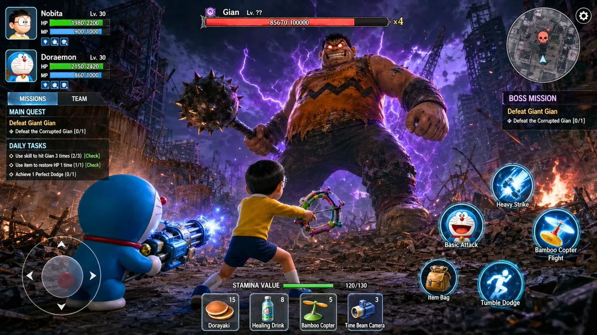

# TechieSA — by @TechieBySA

[← Back to Community Examples](../../EXAMPLES.md) · Category: Illustration & 3D · Model: `GPT Image`

<a href="https://x.com/TechieBySA/status/2047277688075739605"></a>

Source: **[@TechieBySA on X](https://x.com/TechieBySA/status/2047277688075739605)** · Creator: [TechieSA](https://x.com/TechieBySA)

## Prompt

```text
A high-resolution, photorealistic 3D action RPG mobile game screenshot of an epic battle featuring Doraemon characters. The perspective is from behind the main player character, Nobita. The background is a post-apocalyptic urban scene of rubble, crumbling concrete, rebar, debris, small fires, and intense purple and blue lightning in a dark, cloudy night sky.  Characters:  Foreground Left: Doraemon, holding an elaborate, multi-barrel gatling-style cannon which hums with blue energy in his hand.  Foreground Center: Nobita, in a combat stance with his multi-layered slingshot weapon, wearing his classic yellow shirt, blue shorts, and glasses.  Middle Ground Center: Giant Gian (the boss), massive, muscular, intimidating, holding a spiked mace, with glowing sinister red eyes and surrounded by purple energy effects.  Nameplates: Doraemon (Lv. 30, HP: 2150/2420, MP: 860/1000), Nobita (Lv. 30, HP: 1980/2200, MP: 900/1000), Gian (Lv. ??, HP: 85670/100000, x4).  UI Elements (All in English):  Left Side Panel: The title is "MISSIONS" and "TEAM". The "MAIN QUEST" header is followed by "Defeat Giant Gian" and "Defeat the Corrupted Gian [0/1]". The "DAILY TASKS" header is followed by "Use skill to hit Gian 3 times (2/3) [Check]", "Use item to restore HP 1 time (1/1) [Check]", and "Achieve 1 Perfect Dodge (0/1)".  Right Side Panel: The header "BOSS MISSION" is followed by "Defeat Giant Gian" and "Defeat the Corrupted Gian [0/1]".  Bottom Right Skill Buttons: Labels (clockwise from top): "Heavy Strike", "Basic Attack" (with Doraemon head), "Bamboo Copter Flight", "Item Bag", "Tumble Dodge". Glowing blue skill icons are present.  Bottom Center Item Bar: Above the items, "STAMINA VALUE" followed by "120/130". The items are "Dorayaki (15)", "Healing Drink (8)", "Bamboo Copter (5)", "Time Beam Camera (3)".  Mini-Map: Top right corner mini-map with skull icon.  D-pad: English text virtual D-pad on the bottom left.  Screen Details: Cinematic lighting and effects. The cool blue of Doraemon's weapon light, warm orange firelight, cold purple lightning, and Gian's sinister red eyes. Detailed textures on clothing and weapons. All English text is clean, legible, and accurate. The low-angle emphasizes the scale difference and battle tension.
```

## Try it

Paste the prompt into **[vinano.ai](https://vinano.ai?utm_source=github&utm_medium=readme&utm_campaign=awesome-image-video-prompts-updating&utm_content=x-page-try)** to generate your own version.

> The image and prompt belong to @TechieBySA ([original post](https://x.com/TechieBySA/status/2047277688075739605)) and are shown here with credit for reference. Creators can ask for changes or removal by opening an issue.
