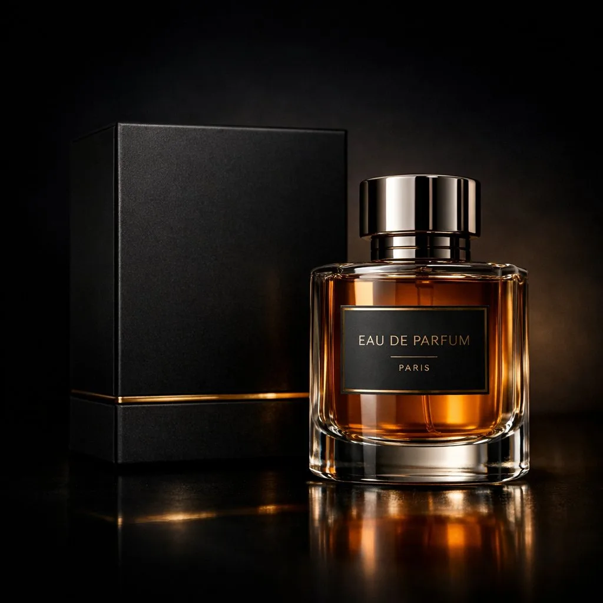

# Harboriis — by @harboriis

[← Back to Examples from X](../../EXAMPLES.md) · Category: Product & Brand · Model: `GPT Image`

<a href="https://x.com/harboriis/status/2019001339985133694"></a>

Original post: **[@harboriis on X](https://x.com/harboriis/status/2019001339985133694)** · Creator: [Harboriis](https://x.com/harboriis)

## Prompt

```text
Luxury perfume product photography in a dark cinematic studio. A premium black matte perfume box with sharp edges and subtle gold accents placed slightly behind a transparent glass perfume bottle filled with warm amber liquid. The bottle has a thick clear glass body and a polished metallic cap. Minimal elegant label design with gold typography. Soft low key lighting with a smooth gradient dark background. Gentle reflections on a glossy surface beneath the products. Dramatic shadows for depth and contrast. High fashion fragrance advertisement style. Ultra realistic textures crisp focus shallow depth of field professional studio shot 8k quality.
```

## Try it

Paste the prompt into **[vinano.ai](https://vinano.ai?utm_source=github&utm_medium=readme&utm_campaign=awesome-image-video-prompts-updating&utm_content=x-page-try)** to generate your own version.

> The image and prompt belong to [@harboriis](https://x.com/harboriis) and are shown here with credit for reference. Creators can ask for changes or removal by opening an issue.
