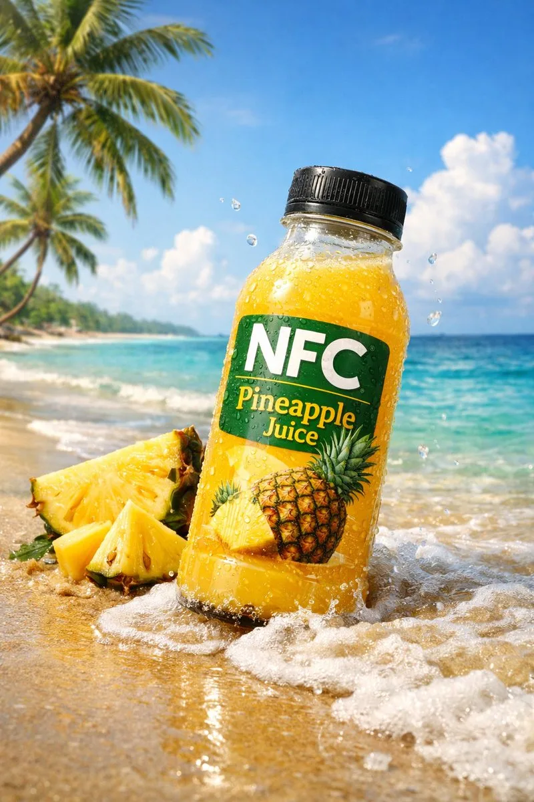

# ShaHid WaNii — by @meng_dagg695

[← Back to Examples from X](../../EXAMPLES.md) · Category: Food & Drink · Model: `GPT Image`

<a href="https://x.com/meng_dagg695/status/2004935778183590081"></a>

Original post: **[@meng_dagg695 on X](https://x.com/meng_dagg695/status/2004935778183590081)** · Creator: [ShaHid WaNii](https://x.com/meng_dagg695)

## Prompt

```text
[
  {
    "id": "pineapple_beach_v2",
    "type": "photorealistic advertising shot",
    "subject": {
      "item": "pineapple juice bottle",
      "label_text": "NFC Pineapple Juice",
      "pose": "slightly tilted forward"
    },
    "environment": {
      "location": "tropical beach",
      "ground": "sunlit wet tropical sand",
      "background_elements": [
        "gently swaying palm trees",
        "clear turquoise ocean with soft waves",
        "bright blue sky with thin clouds"
      ],
      "interactions": "a small wave splashes lightly against the bottle base"
    },
    "surrounding_elements": [
      "fresh pineapple slices with visible texture",
      "sparkling seawater droplets in mid-air"
    ],
    "lighting": {
      "description": "golden sunlight",
      "effects": "soft reflections on glass bottle"
    }
  },

  {
    "id": "strawberry_mountain_v2",
    "type": "photorealistic advertising shot",
    "subject": {
      "item": "strawberry juice bottle",
      "label_text": "NFC Strawberry Juice",
      "details": "heavy condensation with frost accents"
    },
    "environment": {
      "location": "high-altitude mountains",
      "ground": "icy rocks with light snow patches",
      "atmosphere": "crisp cold air with drifting mist"
    },
    "surrounding_elements": [
      "fresh strawberries partially resting on ice"
    ],
    "lighting": {
      "description": "soft sunrise light cutting through fog",
      "effects": "subtle glow around the bottle"
    },
    "style_descriptors": [
      "cinematic macro shot",
      "ultra high detail",
      "cold-meets-warm contrast",
      "deep red highlights",
      "fresh and premium feel",
      "hyper-realistic surface details"
    ],
    "parameters": "--ar 9:16 --stylize 250"
  },

  {
    "id": "citrus_grove_v2",
    "type": "photorealistic advertising shot",
    "subject": {
      "item": "citrus blend juice bottle",
      "label_text": "NFC Citrus Mix",
      "pose": "centered upright"
    },
    "environment": {
      "location": "lush citrus grove",
      "background_elements": [
        "sunlit yellow and orange fruits hanging above",
        "soft green leaves framing the bottle"
      ]
    },
    "action_elements": {
      "description": "fresh splash of clear water rising around the base",
      "items": [
        "thin lemon slices",
        "juicy lime wedges",
        "bright orange segments"
      ]
    },
    "lighting": {
      "description": "sun rays filtering through leaves",
      "tone": "vibrant citrus warmth"
    },
    "parameters": "--ar 9:16 --stylize 250"
  },

  {
    "id": "tropical_hammock_v2",
    "type": "photorealistic advertising shot",
    "subject": {
      "item": "tropical mixed Nestle juice bottle",
      "label_text": "NFC Tropical Juice",
      "pose": "relaxed tilt as if resting"
    },
    "environment": {
      "location": "sunlit hammock between palm trees",
      "background": "soft-focus ocean horizon with glowing sunlight"
    },
    "surrounding_elements": [
      "fresh pineapple slices",
      "ripe mango slices",
      "orange wedges",
      "dragonfruit cubes"
    ],
    "mood_and_style": {
      "atmosphere": "luxury vacation vibe",
      "colors": "rich tropical saturation",
      "lighting": "warm cinematic highlights with soft shadows"
    },
    "parameters": "--ar 9:16 --stylize 250"
  }
]
```

## Try it

Paste the prompt into **[vinano.ai](https://vinano.ai?utm_source=github&utm_medium=readme&utm_campaign=awesome-image-video-prompts-updating&utm_content=x-page-try)** to generate your own version.

> The image and prompt belong to [@meng_dagg695](https://x.com/meng_dagg695) and are shown here with credit for reference. Creators can ask for changes or removal by opening an issue.
