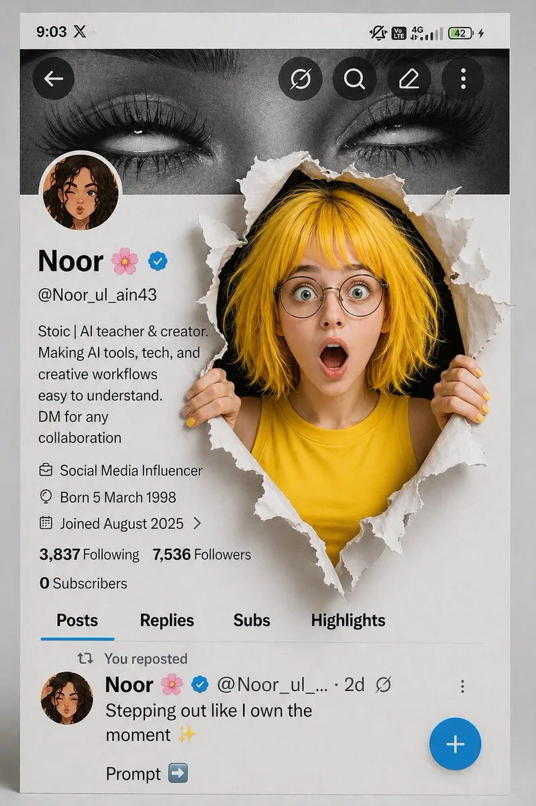

# Noor 🌸 — by @Noor_ul_ain43

[← Back to Community Examples](../../EXAMPLES.md) · Category: UI & Graphic · Model: `GPT Image`

<a href="https://x.com/Noor_ul_ain43/status/2048088005836173316"></a>

Source: **[@Noor_ul_ain43 on X](https://x.com/Noor_ul_ain43/status/2048088005836173316)** · Creator: [Noor 🌸](https://x.com/Noor_ul_ain43)

## Prompt

```text
A creative 3D photo manipulation of a social media profile interface, featuring a surprised young woman with short messy yellow hair, round glasses, and expressive wide eyes, wearing a sleeveless yellow top. She is breaking through a torn paper effect from the screen, holding the ripped edges with both hands. The tear reveals a dark background behind her, adding depth. The UI resembles a modern social media profile page with profile picture, username “Noor 🌸”, verified badge, bio text, and follower stats. Top banner shows a black-and-white close-up of eyes. Clean minimal layout, soft shadows, realistic lighting, high detail, depth-of-field, ultra-realistic textures, cinematic composition, vibrant color contrast, trending AI art style, 4K resolution.
```

## Try it

Paste the prompt into **[vinano.ai](https://vinano.ai?utm_source=github&utm_medium=readme&utm_campaign=awesome-image-video-prompts-updating&utm_content=x-page-try)** to generate your own version.

> The image and prompt belong to @Noor_ul_ain43 ([original post](https://x.com/Noor_ul_ain43/status/2048088005836173316)) and are shown here with credit for reference. Creators can ask for changes or removal by opening an issue.
