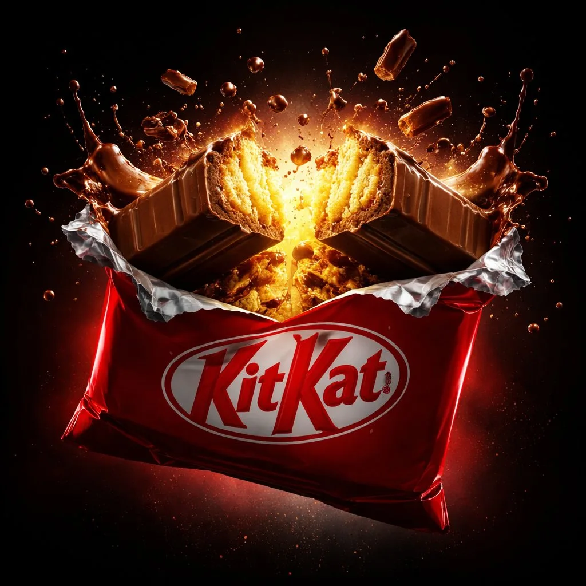

# ShaHid WaNii — by @meng_dagg695

[← Back to Community Examples](../../EXAMPLES.md) · Category: Food & Drink · Model: `GPT Image`

<a href="https://x.com/meng_dagg695/status/2006643289185989070"></a>

Source: **[@meng_dagg695 on X](https://x.com/meng_dagg695/status/2006643289185989070)** · Creator: [ShaHid WaNii](https://x.com/meng_dagg695)

## Prompt

```text
A premium [BRAND NAME] [PRODUCT TYPE] centered in the frame, iconic [BRAND COLOR / PACKAGING STYLE] packaging partially unwrapped, emerging from darkness like a legendary luxury artifact, rich [PRODUCT MATERIAL – chocolate / cream / liquid / filling] cracking open and transforming in slow motion, surreal transformation in progress, [CORE INGREDIENT / FLAVOR ELEMENT] flowing, melting, or bursting outward in cinematic waves, fragments and droplets levitating in zero gravity, slow-motion splash frozen mid-air, ultra-detailed glossy textures, realistic material physics, rich highlights and reflections, dramatic cinematic rim lighting, deep shadows, luxury advertising aesthetic, dreamlike surreal atmosphere, hyper-real product photography blended with fantasy, macro depth of field, clean dark background with subtle [BRAND COLOR] glow, product dominant and razor-sharp, brand name clearly visible on packaging, no extra text, no watermark, no extra logos, 8K ultra-HD, HDR, global illumination, unreal engine style, viral commercial look, high contrast, premium composition
```

## Try it

Paste the prompt into **[vinano.ai](https://vinano.ai?utm_source=github&utm_medium=readme&utm_campaign=awesome-image-video-prompts-updating&utm_content=x-page-try)** to generate your own version.

> The image and prompt belong to @meng_dagg695 ([original post](https://x.com/meng_dagg695/status/2006643289185989070)) and are shown here with credit for reference. Creators can ask for changes or removal by opening an issue.
