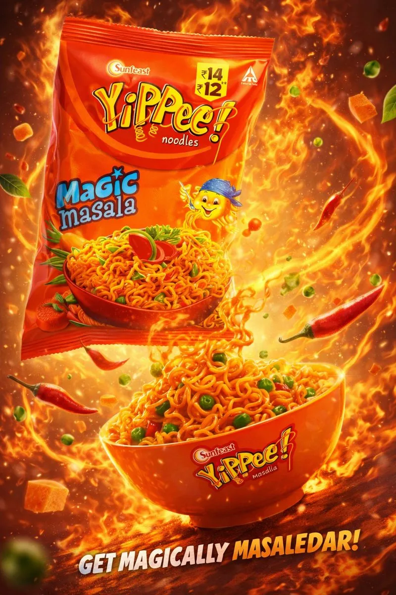

# ShaHid WaNii — by @meng_dagg695

[← Back to Examples from X](../../EXAMPLES.md) · Category: Food & Drink · Model: `GPT Image`

<a href="https://x.com/meng_dagg695/status/2008810720826478640"></a>

Original post: **[@meng_dagg695 on X](https://x.com/meng_dagg695/status/2008810720826478640)** · Creator: [ShaHid WaNii](https://x.com/meng_dagg695)

## Prompt

```text
Ultra-high-resolution 8K cinematic commercial food advertisement of **[BRAND NAME] instant noodles**, vertical 3:4 aspect ratio.

A bold hero composition featuring the **[BRAND NAME] noodle packet** floating in the upper frame, front-facing and perfectly lit, with crisp edges, realistic packaging texture, and clear branding. Below it, a steaming bowl branded with **[BRAND NAME]**, filled with glossy, curly noodles lifted dramatically mid-air using chopsticks, noodles stretching naturally under gravity.

Noodles appear richly coated in **[FLAVOR / SAUCE TYPE]**, with visible ingredients such as **[VEGETABLES / CHILIES / GARNISH]** suspended mid-air around the bowl. Steam rises dynamically, interacting with floating spice particles and food fragments.

Background is a **completely new cinematic environment** (not copied from reference), abstract and high-energy, filled with swirling flames, sparks, embers, smoke, and motion blur, creating depth and intensity while keeping the food in sharp focus.

Lighting is premium studio cinematic lighting:
warm golden key light, soft fill light, strong rim light outlining the packet and noodles, high contrast with glowing highlights and deep shadows.

Color palette dominated by **[PRIMARY BRAND COLORS]**, enhanced with warm orange-gold food tones and contrasting greens from vegetables. Hyper-realistic textures on noodles, sauce, packaging, and bowl.

Shallow depth of field, dramatic bokeh in background, extreme sharpness on hero elements, photorealistic yet stylized for advertising impact.

Mood: bold, energetic, spicy, indulgent, mouth-watering, premium commercial look.

No people, no clutter, no copied backgrounds. Designed for high-impact food advertising, posters, and social media hero visuals.

[BRAND NAME] → Maggi
[FLAVOR / SAUCE TYPE] → spicy masala
[PRIMARY BRAND COLORS] → yellow and red
```

## Try it

Paste the prompt into **[vinano.ai](https://vinano.ai?utm_source=github&utm_medium=readme&utm_campaign=awesome-image-video-prompts-updating&utm_content=x-page-try)** to generate your own version.

> The image and prompt belong to [@meng_dagg695](https://x.com/meng_dagg695) and are shown here with credit for reference. Creators can ask for changes or removal by opening an issue.
