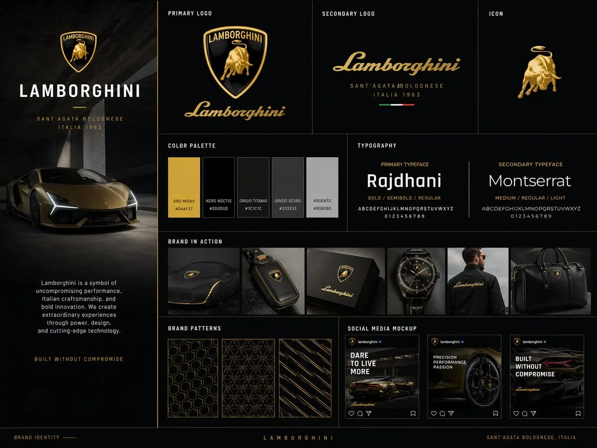

# MayorkingAI — by @MayorKingAI

[← Back to Examples from X](../../EXAMPLES.md) · Category: Product & Brand · Model: `GPT Image`

<a href="https://x.com/MayorKingAI/status/2047375056125428013"></a>

Original post: **[@MayorKingAI on X](https://x.com/MayorKingAI/status/2047375056125428013)** · Creator: [MayorkingAI](https://x.com/MayorKingAI)

## Prompt

```text
Create a premium brand kit board for [BRAND NAME], presented like a professional branding studio slide. Show the existing brand identity in a clean, organized visual presentation. Include primary logo, secondary logo, icon, [COLOR PALETTE], typography pairing, branded packaging or product mockups, social media mockup, and simple brand pattern elements. Style: [STYLE]. Use a clean editorial grid, realistic materials, strong hierarchy, and polished presentation. Text to include: "[BRAND NAME]
```

## Try it

Paste the prompt into **[vinano.ai](https://vinano.ai?utm_source=github&utm_medium=readme&utm_campaign=awesome-image-video-prompts-updating&utm_content=x-page-try)** to generate your own version.

> The image and prompt belong to [@MayorKingAI](https://x.com/MayorKingAI) and are shown here with credit for reference. Creators can ask for changes or removal by opening an issue.
