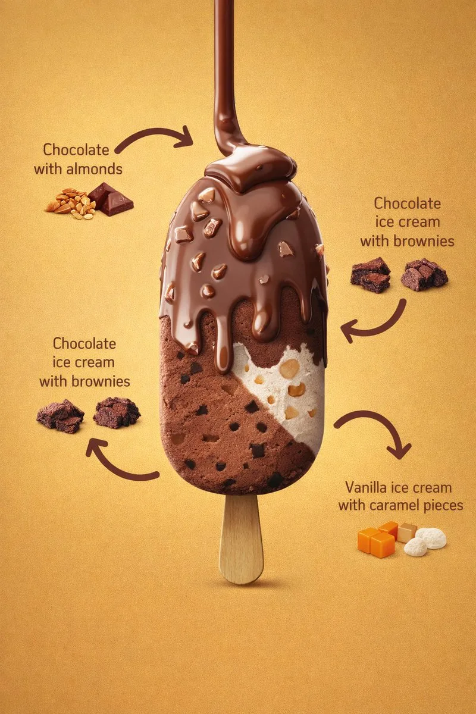

# ShaHid WaNii — by @meng_dagg695

[← Back to Examples from X](../../EXAMPLES.md) · Category: Food & Drink · Model: `GPT Image`

<a href="https://x.com/meng_dagg695/status/2020329970497999135"></a>

Original post: **[@meng_dagg695 on X](https://x.com/meng_dagg695/status/2020329970497999135)** · Creator: [ShaHid WaNii](https://x.com/meng_dagg695)

## Prompt

```text
{
  "resolution": "8K",
  "aspect_ratio": "3:4",
  "image_type": "photorealistic commercial product render",
  "scene_description": {
    "main_subject": "A vertically centered ice cream bar on a wooden stick",
    "orientation": "upright, front-facing, slightly elevated perspective",
    "composition": "single product centered with surrounding ingredient callouts and curved arrows"
  },
  "background": {
    "color": "warm golden-yellow gradient",
    "texture": "smooth, matte, evenly lit",
    "lighting_falloff": "subtle vignette, darker towards edges"
  },
  "lighting": {
    "type": "studio lighting",
    "key_light": "soft frontal light highlighting chocolate gloss",
    "fill_light": "balanced fill to preserve texture detail",
    "specular_highlights": "visible on melted chocolate coating",
    "shadows": "soft shadow beneath ice cream stick"
  },
  "ice_cream_bar": {
    "shape": "rounded rectangular bar",
    "surface": "smooth with visible embedded inclusions",
    "layers": [
      {
        "layer_position": "top coating",
        "material": "milk chocolate",
        "state": "melted and dripping",
        "texture": "glossy, thick, fluid",
        "details": [
          "multiple chocolate drips flowing downward",
          "irregular almond pieces embedded in coating",
          "rounded drip edges with gravity pull"
        ]
      },
      {
        "layer_position": "left interior",
        "material": "chocolate ice cream",
        "texture": "dense, creamy",
        "details": [
          "small dark brownie chunks evenly dispersed",
          "matte finish compared to outer chocolate"
        ]
      },
      {
        "layer_position": "right interior",
        "material": "vanilla ice cream",
        "texture": "smooth and creamy",
        "details": [
          "visible caramel pieces",
          "light beige caramel chunks with rounded edges"
        ]
      }
    ]
  },
  "stick": {
    "material": "light natural wood",
    "texture": "smooth with subtle grain",
    "shape": "rounded edges, flat profile",
    "visibility": "fully visible below ice cream bar"
  },
  "ingredient_callouts": {
    "style": {
      "arrows": "curved, thick, dark brown",
      "text_color": "dark brown",
      "font_style": "clean sans-serif",
      "layout": "balanced around product"
    },
    "labels": [
      {
        "text": "Chocolate with almonds",
        "position": "top-left",
        "visual_aid": [
          "whole almonds",
          "small chocolate squares"
        ]
      },
      {
        "text": "Chocolate ice cream with brownies",
        "position": "left-middle",
        "visual_aid": [
          "brownie chunks"
        ]
      },
      {
        "text": "Chocolate ice cream with brownies",
        "position": "right-middle",
        "visual_aid": [
          "brownie chunks"
        ]
      },
      {
        "text": "Vanilla ice cream with caramel pieces",
        "position": "bottom-right",
        "visual_aid": [
          "caramel cubes",
          "white vanilla pieces"
        ]
      }
    ]
  },
  "color_palette": {
    "primary_colors": [
      "milk chocolate brown",
      "golden yellow",
      "cream white"
    ],
    "secondary_colors": [
      "dark brownie brown",
      "light caramel orange",
      "almond beige"
    ]
  },
  "render_quality": {
    "sharpness": "extreme micro-detail visibility",
    "texture_fidelity": "high realism",
    "noise": "none",
    "depth_of_field": "moderate, product fully in focus"
  },
  "style_tags": [
    "luxury dessert advertising",
    "hyper-realistic food photography",
    "commercial product render",
    "clean studio composition"
  ]
}
```

## Try it

Paste the prompt into **[vinano.ai](https://vinano.ai?utm_source=github&utm_medium=readme&utm_campaign=awesome-image-video-prompts-updating&utm_content=x-page-try)** to generate your own version.

> The image and prompt belong to [@meng_dagg695](https://x.com/meng_dagg695) and are shown here with credit for reference. Creators can ask for changes or removal by opening an issue.
