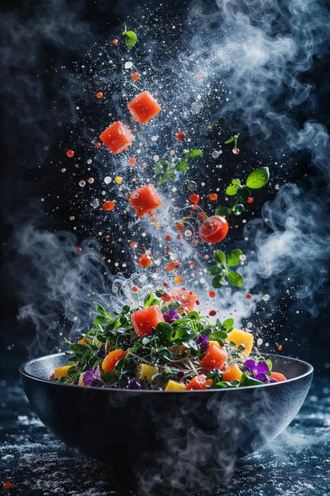

# K — by @ChillaiKalan__

[← Back to Examples from X](../../EXAMPLES.md) · Category: Food & Drink · Model: `GPT Image`

<a href="https://x.com/ChillaiKalan__/status/2017200760631828679"></a>

Original post: **[@ChillaiKalan__ on X](https://x.com/ChillaiKalan__/status/2017200760631828679)** · Creator: [K](https://x.com/ChillaiKalan__)

## Prompt

```text
{
  "global_settings": {
    "resolution": "8K ultra high definition",
    "aspect_ratio": "2:3 vertical",
    "style": "hyper-realistic AI-edited food photography",
    "clarity": "extreme sharpness, micro-texture visibility",
    "motion": "frozen action with suspended ingredients",
    "lighting_quality": "studio-grade, high-contrast, cinematic",
    "background_separation": "strong subject isolation with clean depth"
  },

  "module_1_image_1_style": {
    "scene_description": "A dynamic salad explosion emerging from a matte black bowl placed on a round wooden surface. Ingredients are mid-air, scattered upward and outward.",
    "ingredients_visible": [
      "green lettuce leaves",
      "cherry tomatoes (whole and sliced)",
      "cucumber slices arranged in a curved stack",
      "black olives",
      "white cheese cubes",
      "orange citrus slice",
      "small broccoli florets",
      "fresh green basil leaves"
    ],
    "motion_details": {
      "ingredients":
```

## Try it

Paste the prompt into **[vinano.ai](https://vinano.ai?utm_source=github&utm_medium=readme&utm_campaign=awesome-image-video-prompts-updating&utm_content=x-page-try)** to generate your own version.

> The image and prompt belong to [@ChillaiKalan__](https://x.com/ChillaiKalan__) and are shown here with credit for reference. Creators can ask for changes or removal by opening an issue.
