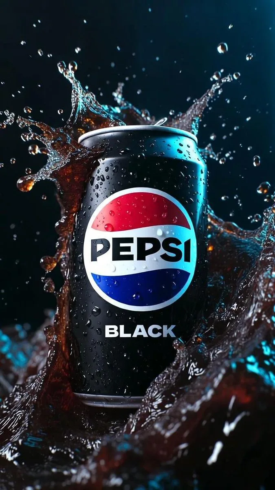

# simeon-sanai — by @Naiknelofar788

[← Back to Examples from X](../../EXAMPLES.md) · Category: Product & Brand · Model: `GPT Image`

<a href="https://x.com/Naiknelofar788/status/2020531946108158457"></a>

Original post: **[@Naiknelofar788 on X](https://x.com/Naiknelofar788/status/2020531946108158457)** · Creator: [simeon-sanai](https://x.com/Naiknelofar788)

## Prompt

```text
Hyper-realistic cinematic product photograph of a Pepsi Black can, front-facing and perfectly legible, ice-cold surface covered in crisp condensation. Dark cola splashes explode around the can in frozen motion, glossy liquid waves and fine droplets catching the light. Moody low-key lighting with cool blue rim light and soft front fill, shallow depth of field, ultra-sharp texture detail, high-end advertising aesthetic.
```

## Try it

Paste the prompt into **[vinano.ai](https://vinano.ai?utm_source=github&utm_medium=readme&utm_campaign=awesome-image-video-prompts-updating&utm_content=x-page-try)** to generate your own version.

> The image and prompt belong to [@Naiknelofar788](https://x.com/Naiknelofar788) and are shown here with credit for reference. Creators can ask for changes or removal by opening an issue.
