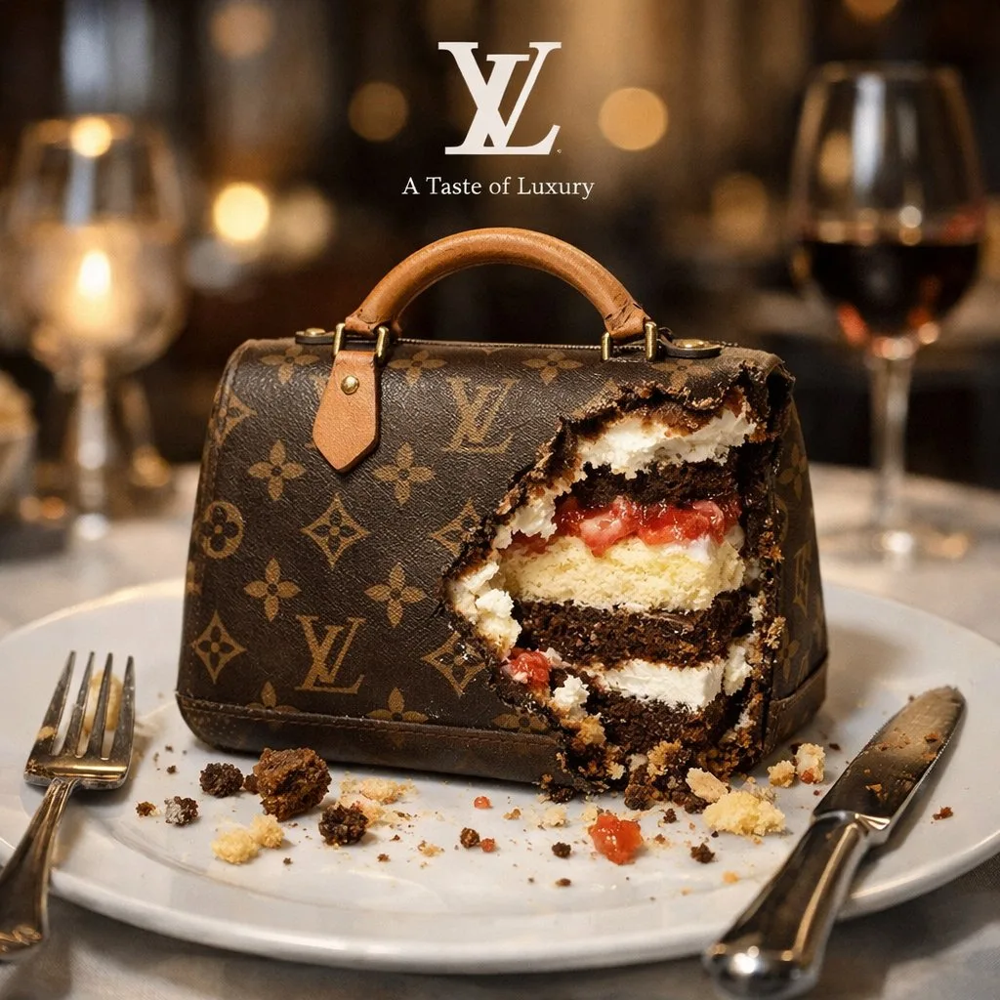

# Howard Chen ✦ — by @hc_dsn

[← Back to Examples from X](../../EXAMPLES.md) · Category: Product & Brand · Model: `GPT Image`

<a href="https://x.com/hc_dsn/status/2003072041889800346"></a>

Original post: **[@hc_dsn on X](https://x.com/hc_dsn/status/2003072041889800346)** · Creator: [Howard Chen ✦](https://x.com/hc_dsn)

## Prompt

```text
A bitten realistic classic [brand] product on the dish, revealed inner dessert layers, and there are cake crumbs near, finished fork and knife near by, against blurry high end restaurant background, white small logo on top of background, beneath the logo, there is a tiny brand slogan that suit this scene.
```

## Try it

Paste the prompt into **[vinano.ai](https://vinano.ai?utm_source=github&utm_medium=readme&utm_campaign=awesome-image-video-prompts-updating&utm_content=x-page-try)** to generate your own version.

> The image and prompt belong to [@hc_dsn](https://x.com/hc_dsn) and are shown here with credit for reference. Creators can ask for changes or removal by opening an issue.
