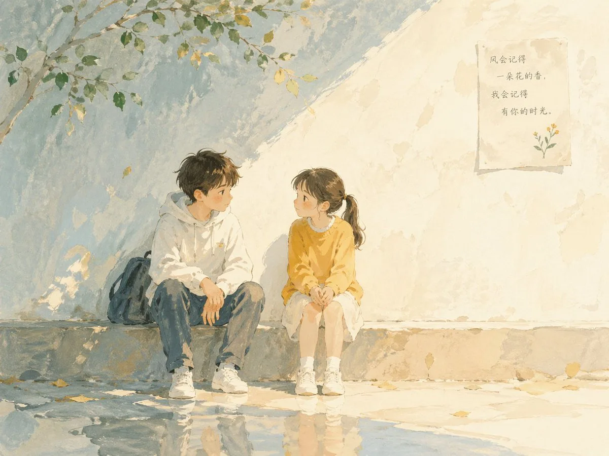

# 宝玉 — by @dotey

[← Back to Community Examples](../../EXAMPLES.md) · Category: Illustration & 3D · Model: `GPT Image`

<a href="https://x.com/dotey/status/2047174895293849972"></a>

Source: **[@dotey on X](https://x.com/dotey/status/2047174895293849972)** · Creator: [宝玉](https://x.com/dotey)

## Prompt

```text
Soft poetic children's book illustration with watercolor and gouache textures.Clear gentle daylight with slightly brighter highlights.Muted pastel colors with soft blue and warm tones.Visible brush strokes and paper grain.Minimalist composition with large negative space.Calm, thoughtful, slightly open-ended atmosphere.

Child character (around 12 years old).Subtle visual metaphors like light, shadow, perspective, reflection.Hand-painted picture book style, not cartoon, not anime, not 3D.

Two children in calm conversation,soft connection forming.
```

## Try it

Paste the prompt into **[vinano.ai](https://vinano.ai?utm_source=github&utm_medium=readme&utm_campaign=awesome-image-video-prompts-updating&utm_content=x-page-try)** to generate your own version.

> The image and prompt belong to @dotey ([original post](https://x.com/dotey/status/2047174895293849972)) and are shown here with credit for reference. Creators can ask for changes or removal by opening an issue.
