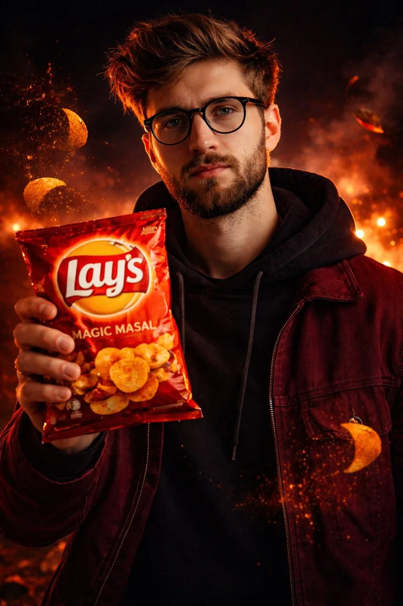

# Duet | AI — by @Sheldon056

[← Back to Community Examples](../../EXAMPLES.md) · Category: Photography · Model: `GPT Image`

<a href="https://x.com/Sheldon056/status/2012714937089749208"></a>

Source: **[@Sheldon056 on X](https://x.com/Sheldon056/status/2012714937089749208)** · Creator: [Duet | AI](https://x.com/Sheldon056)

## Prompt

```text
A cinematic, ultra-realistic advertising shot of a man holding a Lay’s [FLAVOR NAME] chips packet in his hand.
The packet color, branding, and typography are perfectly accurate to Lay’s official design.
The man’s outfit color, texture, and style match the packet theme (same color palette and mood), modern and stylish, premium fashion look.
His pose is confident and natural, hand clearly gripping the Lay’s packet in the foreground.
Background environment matches the flavor theme — spices, ingredients, atmosphere, and lighting inspired by the flavor (for example: fiery spices for masala, fresh greens for sour cream, smoky tones for barbecue).
Chips are flying in slow motion around the scene with realistic motion blur and seasoning particles in the air.
Dramatic golden-hour lighting, cinematic depth of field, sharp focus on the packet, soft background bokeh.
Hyper-realistic textures, commercial food photography, high contrast, rich colors, ultra-detailed, 8K quality, professional brand advertisement style.
```

## Try it

Paste the prompt into **[vinano.ai](https://vinano.ai?utm_source=github&utm_medium=readme&utm_campaign=awesome-image-video-prompts-updating&utm_content=x-page-try)** to generate your own version.

> The image and prompt belong to @Sheldon056 ([original post](https://x.com/Sheldon056/status/2012714937089749208)) and are shown here with credit for reference. Creators can ask for changes or removal by opening an issue.
