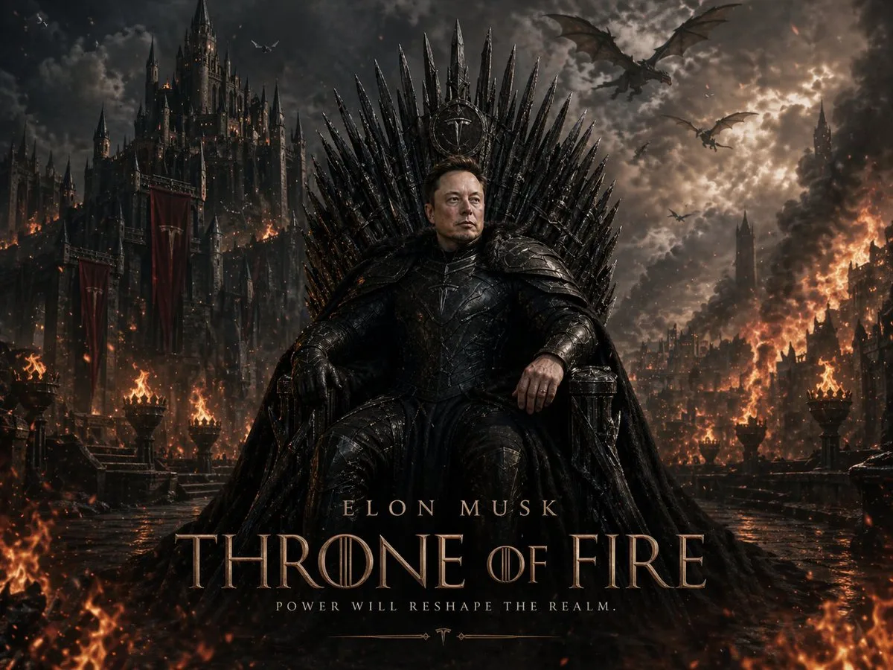

# Amira Zairi — by @azed_ai

[← Back to Community Examples](../../EXAMPLES.md) · Category: Poster Design · Model: `GPT Image`

<a href="https://x.com/azed_ai/status/2047676720707482049"></a>

Source: **[@azed_ai on X](https://x.com/azed_ai/status/2047676720707482049)** · Creator: [Amira Zairi](https://x.com/azed_ai)

## Prompt

```text
A cinematic epic sci-fi fantasy movie poster featuring three powerful tech leaders standing together as rival kings of artificial intelligence, dramatic futuristic battlefield, dark stormy sky, glowing AI energy, towering digital fortress in the background, armies of advanced robots below, intense blue and golden lighting contrast, ultra-detailed armor-inspired futuristic outfits, heroic serious expressions, high-budget streaming series poster style, dramatic composition, sharp facial details, atmospheric smoke, lightning, sparks, cinematic depth, professional poster typography with the title “THE FINAL AI BATTLE”, subtitle “The future is intelligent. The battle is real.”, 4:3 aspect ratio
```

## Try it

Paste the prompt into **[vinano.ai](https://vinano.ai?utm_source=github&utm_medium=readme&utm_campaign=awesome-image-video-prompts-updating&utm_content=x-page-try)** to generate your own version.

> The image and prompt belong to @azed_ai ([original post](https://x.com/azed_ai/status/2047676720707482049)) and are shown here with credit for reference. Creators can ask for changes or removal by opening an issue.
