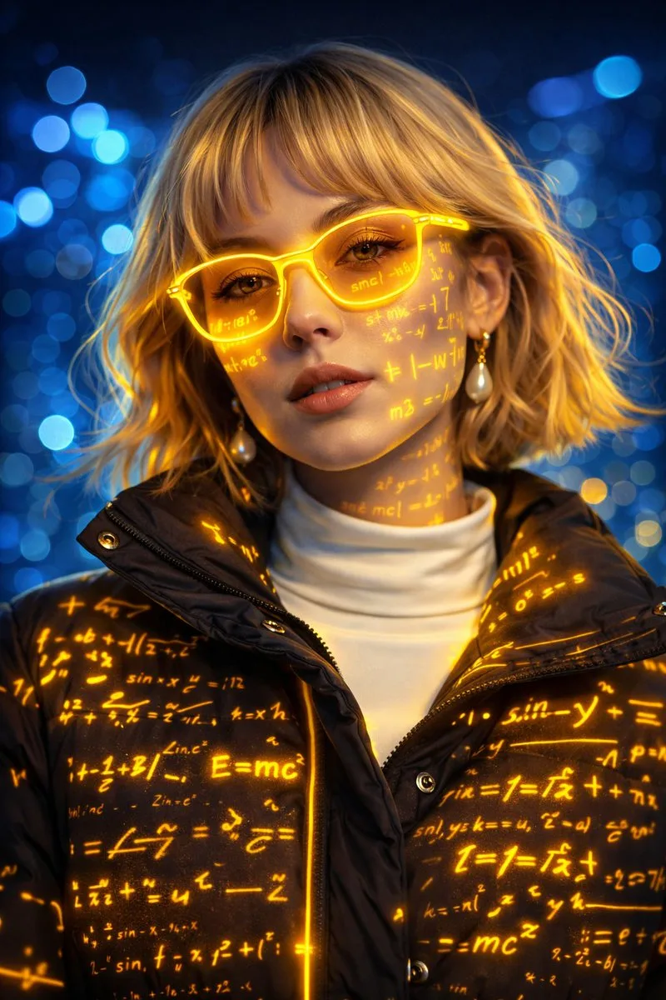

# simeon-sanai — by @Naiknelofar788

[← Back to Community Examples](../../EXAMPLES.md) · Category: Photography · Model: `GPT Image`

<a href="https://x.com/Naiknelofar788/status/2014990545345810674"></a>

Source: **[@Naiknelofar788 on X](https://x.com/Naiknelofar788/status/2014990545345810674)** · Creator: [simeon-sanai](https://x.com/Naiknelofar788)

## Prompt

```text
A futuristic cyber-aesthetic portrait of a young woman wearing glowing neon-yellow glasses, with luminous mathematical equations projected across her face and jacket. Soft bokeh blue lights in the background create a high-tech atmosphereHyper-realistic detail, sharp eyes, smooth skin, and vivid color contrast. Sci-fi digital-glow style, immersive and modern." Her expression is calm and focused. The lighting is vibrant and cinematic, with reflections on the glasses and warm yellow highlights on her clothing.
```

## Try it

Paste the prompt into **[vinano.ai](https://vinano.ai?utm_source=github&utm_medium=readme&utm_campaign=awesome-image-video-prompts-updating&utm_content=x-page-try)** to generate your own version.

> The image and prompt belong to @Naiknelofar788 ([original post](https://x.com/Naiknelofar788/status/2014990545345810674)) and are shown here with credit for reference. Creators can ask for changes or removal by opening an issue.
