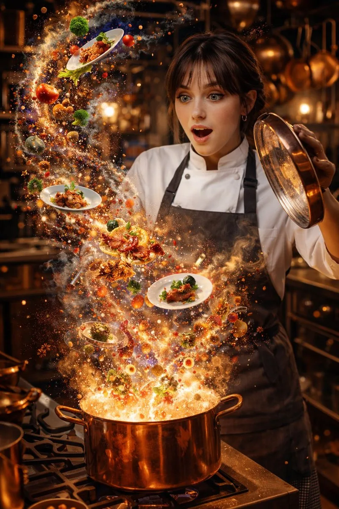

# simeon-sanai — by @Naiknelofar788

[← Back to Community Examples](../../EXAMPLES.md) · Category: Food & Drink · Model: `GPT Image`

<a href="https://x.com/Naiknelofar788/status/2025363555584016837"></a>

Source: **[@Naiknelofar788 on X](https://x.com/Naiknelofar788/status/2025363555584016837)** · Creator: [simeon-sanai](https://x.com/Naiknelofar788)

## Prompt

```text
A hyper-realistic, high-speed commercial photograph featuring a man with uploaded face as reference in a chef's jacket, apron, and checkered trousers. He stands in a rustic, high-end kitchen, lifting the lid off a large, steaming copper pot with a look of pure amazement. From the pot, a literal galaxy of gourmet food explodes upwards and outwards in suspended animation: whole roasted spices, vibrant vegetables, splashes of rich sauces, floating plates of intricately plated fine dining dishes,and swirling clouds of aromatic steam filled with golden glitter. The ingredients form spiral nebulae around him. The background is a warm, blurred professional kitchen with copper cookware hanging. The lighting is warm, cinematic, and focused, highlighting the textures of the flying food with macro-level detail. Shot with a fast shutter speed to freeze motion, 8k resolution, Octane Render culinary aesthetic. 100% use my real face.
```

## Try it

Paste the prompt into **[vinano.ai](https://vinano.ai?utm_source=github&utm_medium=readme&utm_campaign=awesome-image-video-prompts-updating&utm_content=x-page-try)** to generate your own version.

> The image and prompt belong to @Naiknelofar788 ([original post](https://x.com/Naiknelofar788/status/2025363555584016837)) and are shown here with credit for reference. Creators can ask for changes or removal by opening an issue.
