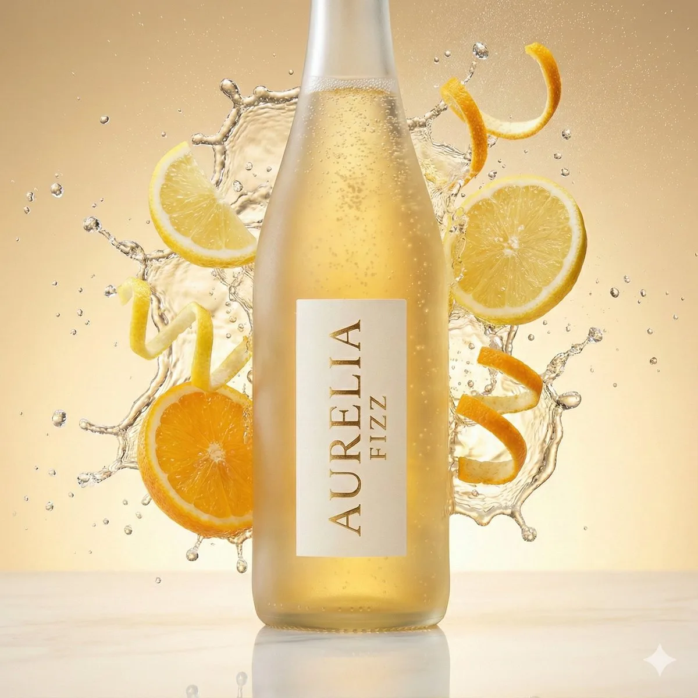

# Jack — by @j_smeaton99

[← Back to Examples from X](../../EXAMPLES.md) · Category: Product & Brand · Model: `GPT Image`

<a href="https://x.com/j_smeaton99/status/2027421733666586809"></a>

Original post: **[@j_smeaton99 on X](https://x.com/j_smeaton99/status/2027421733666586809)** · Creator: [Jack](https://x.com/j_smeaton99)

## Prompt

```text
{
  "master_prompt": {
    "scene_type": "high-speed commercial beverage photography",
    "product": {
      "type": "sleek frosted glass bottle filled with sparkling citrus tonic",
      "brand_name": "AURELIA FIZZ",
      "label_design": "minimalist vertical ivory label with refined gold serif typography",
      "liquid_color": "translucent golden citrus with effervescent bubbles"
    },
    "composition": {
      "action": "dynamic high-velocity liquid splash explosion",
      "surrounding_elements": [
        "sculptural splashes of sparkling tonic water",
        "spiraling ribbons of fresh lemon and orange zest",
        "floating citrus slices with visible pulp texture",
        "tiny suspended carbonation bubbles",
        "mist of fine droplets catching the light"
      ],
      "placement": "centered hero bottle with a crisp reflection on a polished marble surface"
    },
    "lighting": {
      "style": "luxury glossy studio product lighting",
      "effects": [
        "sharp rim lighting to define bottle silhouette",
        "brilliant highlights on splashes and bubbles",
        "soft golden glow in the background for warmth"
      ]
    },
    "color_palette": {
      "background": "sunlit gradient of warm gold fading into soft champagne beige",
      "accents": "citrus yellow, fresh orange, and subtle mint green"
    },
    "technical_specs": {
      "camera": "macro lens, eye-level angle",
      "shutter": "ultra-fast freeze-motion capture",
      "depth_of_field": "shallow focus on the label, gentle blur on dynamic splash elements",
      "quality": "8K resolution, ultra-photorealistic texture"
    }
  }
}
```

## Try it

Paste the prompt into **[vinano.ai](https://vinano.ai?utm_source=github&utm_medium=readme&utm_campaign=awesome-image-video-prompts-updating&utm_content=x-page-try)** to generate your own version.

> The image and prompt belong to [@j_smeaton99](https://x.com/j_smeaton99) and are shown here with credit for reference. Creators can ask for changes or removal by opening an issue.
