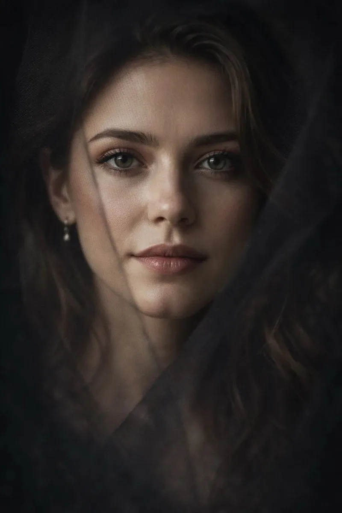

# Professor — by @Professor_134

[← Back to Examples from X](../../EXAMPLES.md) · Category: Photography · Model: `GPT Image`

<a href="https://x.com/Professor_134/status/2022898659336298658"></a>

Original post: **[@Professor_134 on X](https://x.com/Professor_134/status/2022898659336298658)** · Creator: [Professor](https://x.com/Professor_134)

## Prompt

```text
Transform this image [UPLOAD YOUR IMAGE] into a 64K DSLR-quality shot resolution Ultra-hyperrealistic cinematic Create a photorealistic, beauty portrait in a vertical 4:5 frame, captured as a tight close-up to extreme close-up. The framing focuses primarily on the face - from just above the forehead to slightly below the lips — with minimal negative space. The camera is positioned mid-close to the subject (same face as the uploaded
```

## Try it

Paste the prompt into **[vinano.ai](https://vinano.ai?utm_source=github&utm_medium=readme&utm_campaign=awesome-image-video-prompts-updating&utm_content=x-page-try)** to generate your own version.

> The image and prompt belong to [@Professor_134](https://x.com/Professor_134) and are shown here with credit for reference. Creators can ask for changes or removal by opening an issue.
