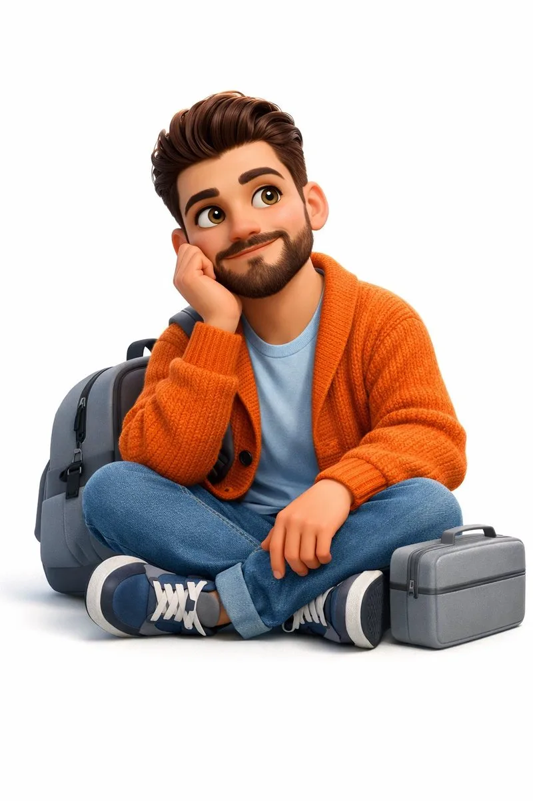

# simeon-sanai — by @Naiknelofar788

[← Back to Community Examples](../../EXAMPLES.md) · Category: Illustration & 3D · Model: `GPT Image`

<a href="https://x.com/Naiknelofar788/status/2023686368162181501"></a>

Source: **[@Naiknelofar788 on X](https://x.com/Naiknelofar788/status/2023686368162181501)** · Creator: [simeon-sanai](https://x.com/Naiknelofar788)

## Prompt

```text
create a A 3D, Pixar-style animated young man sits cross-legged on a pure white, isolated background. He has bright, olive-toned skin, a neatly styled bright brown haircut with a slight wave, and a well-groomed bright brown beard and mustache. His large, expressive eyes, a deep hazel-brown, are slightly upturned and gaze thoughtfully to his left, with a subtle, dreamy smile playing on his lips and his right hand resting gently on his cheek.He wears a bright, textured orange knit cardigan over a light blue t-shirt, complemented by bright wash denim jeans. His footwear consists of stylish sneakers with a navy blue, grey, and white color scheme. A bright grey, modern backpack is slung over his left shoulder, and a matching bright grey lunchbox rests beside his right leg.The lighting is soft and even, creating gentle highlights on his hair and clothing, and a subtle bright beneath him, emphasizing his rounded, stylized form. The overall mood is one of relaxed contemplation and youthful optimism..
```

## Try it

Paste the prompt into **[vinano.ai](https://vinano.ai?utm_source=github&utm_medium=readme&utm_campaign=awesome-image-video-prompts-updating&utm_content=x-page-try)** to generate your own version.

> The image and prompt belong to @Naiknelofar788 ([original post](https://x.com/Naiknelofar788/status/2023686368162181501)) and are shown here with credit for reference. Creators can ask for changes or removal by opening an issue.
