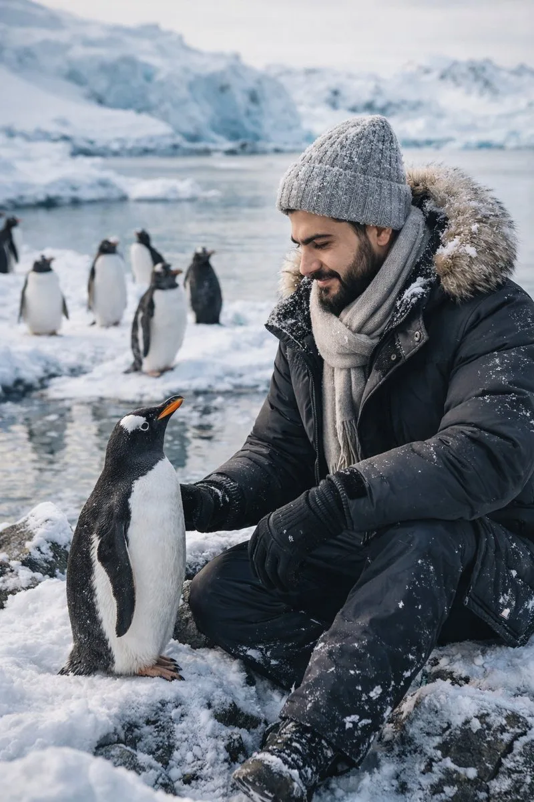

# simeon-sanai — by @Naiknelofar788

[← Back to Examples from X](../../EXAMPLES.md) · Category: Photography · Model: `GPT Image`

<a href="https://x.com/Naiknelofar788/status/2015264060754080239"></a>

Original post: **[@Naiknelofar788 on X](https://x.com/Naiknelofar788/status/2015264060754080239)** · Creator: [simeon-sanai](https://x.com/Naiknelofar788)

## Prompt

```text
Ultra-realistic photo featuring a young man (insert user’s photo) in perfect detail, preserving 100% of his facial features, wearing warm winter clothing suitable for the penguins’ icy habitat (thick jacket, scarf, gloves, beanie). The man is interacting naturally with penguins in their snowy and icy environment (snow, ice, rocks, frozen water reflections).
Include natural and spontaneous photo poses:
– sitting on a rock while touching a penguin
```

## Try it

Paste the prompt into **[vinano.ai](https://vinano.ai?utm_source=github&utm_medium=readme&utm_campaign=awesome-image-video-prompts-updating&utm_content=x-page-try)** to generate your own version.

> The image and prompt belong to [@Naiknelofar788](https://x.com/Naiknelofar788) and are shown here with credit for reference. Creators can ask for changes or removal by opening an issue.
