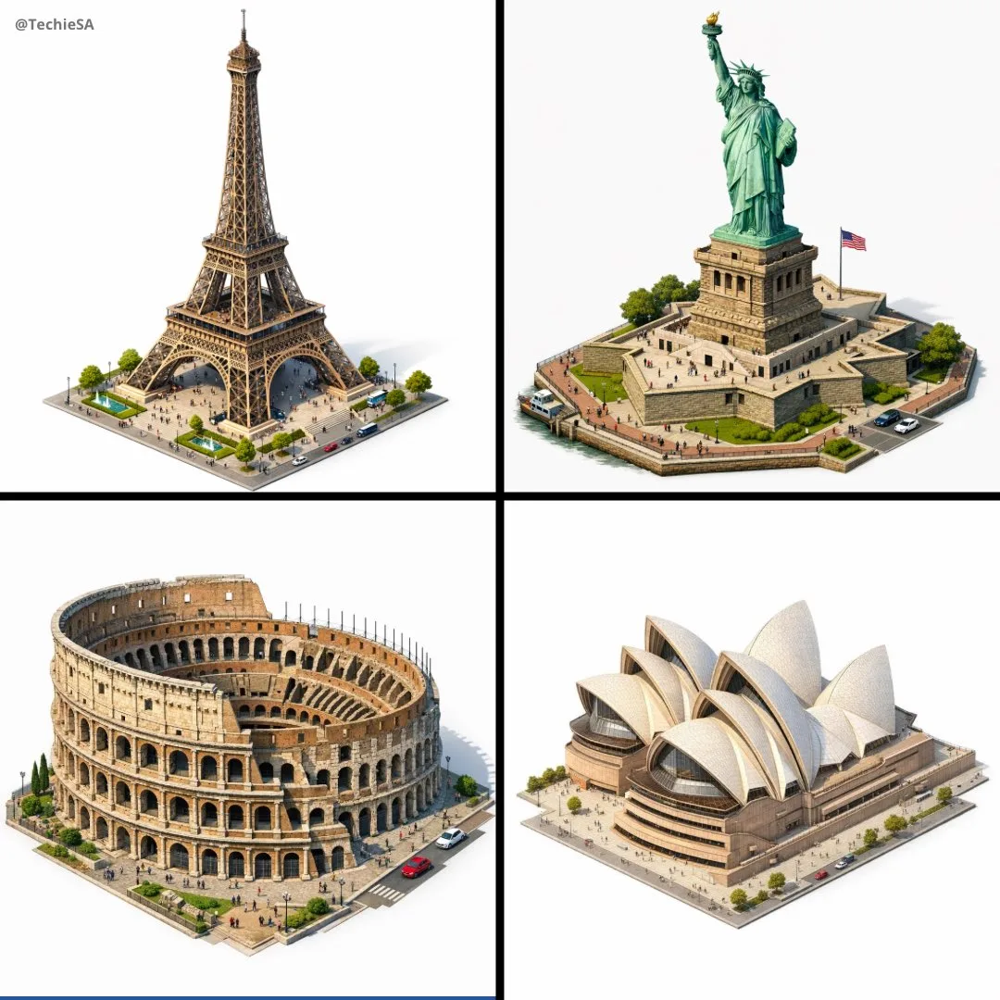

# TechieSA — by @TechieBySA

[← Back to Examples from X](../../EXAMPLES.md) · Category: Illustration & 3D · Model: `GPT Image`

<a href="https://x.com/TechieBySA/status/2007082189742379459"></a>

Original post: **[@TechieBySA on X](https://x.com/TechieBySA/status/2007082189742379459)** · Creator: [TechieSA](https://x.com/TechieBySA)

## Prompt

```text
Create a highly detailed isometric 3D rendering of [LANDMARK] in architectural visualization style. The building is shown at a 45-degree angle from above, displaying three visible sides with intricate architectural detail. Photorealistic textures showing materials like stone, glass, metal, or brick. Include the base/ground level with tiny people, cars, and landscaping for scale. Clean white or light grey background. Professional architectural rendering with soft ambient shadows beneath the structure. Every window, column, ornamental detail, and structural element clearly visible. 1080x1080 dimension, centered composition. Style similar to video game building assets or architectural presentation models - clean, detailed, slightly stylized but realistic.
```

## Try it

Paste the prompt into **[vinano.ai](https://vinano.ai?utm_source=github&utm_medium=readme&utm_campaign=awesome-image-video-prompts-updating&utm_content=x-page-try)** to generate your own version.

> The image and prompt belong to [@TechieBySA](https://x.com/TechieBySA) and are shown here with credit for reference. Creators can ask for changes or removal by opening an issue.
