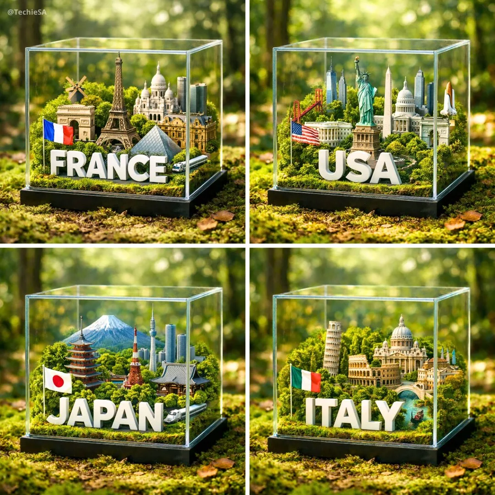

# TechieSA — by @TechieBySA

[← Back to Community Examples](../../EXAMPLES.md) · Category: Illustration & 3D · Model: `GPT Image`

<a href="https://x.com/TechieBySA/status/2008913329029263382"></a>

Source: **[@TechieBySA on X](https://x.com/TechieBySA/status/2008913329029263382)** · Creator: [TechieSA](https://x.com/TechieBySA)

## Prompt

```text
A hyper-realistic 1080x1080 photograph of a glass cube diorama placed on a lush, mossy forest floor with dappled sunlight. Inside the cube are miniature, highly detailed landmarks and cultural icons from [COUNTRY]. Include its most famous and recognizable architecture—traditional and modern—surrounded by greenery. Prominently display the 3D word “COUNTRY” at the base inside the cube, using large, bold white block letters and a flagpole of the country's flag. The scene is crisp, elegant, and immersive, with the forest background softly blurred to focus on the diorama’s sharp details.
```

## Try it

Paste the prompt into **[vinano.ai](https://vinano.ai?utm_source=github&utm_medium=readme&utm_campaign=awesome-image-video-prompts-updating&utm_content=x-page-try)** to generate your own version.

> The image and prompt belong to @TechieBySA ([original post](https://x.com/TechieBySA/status/2008913329029263382)) and are shown here with credit for reference. Creators can ask for changes or removal by opening an issue.
