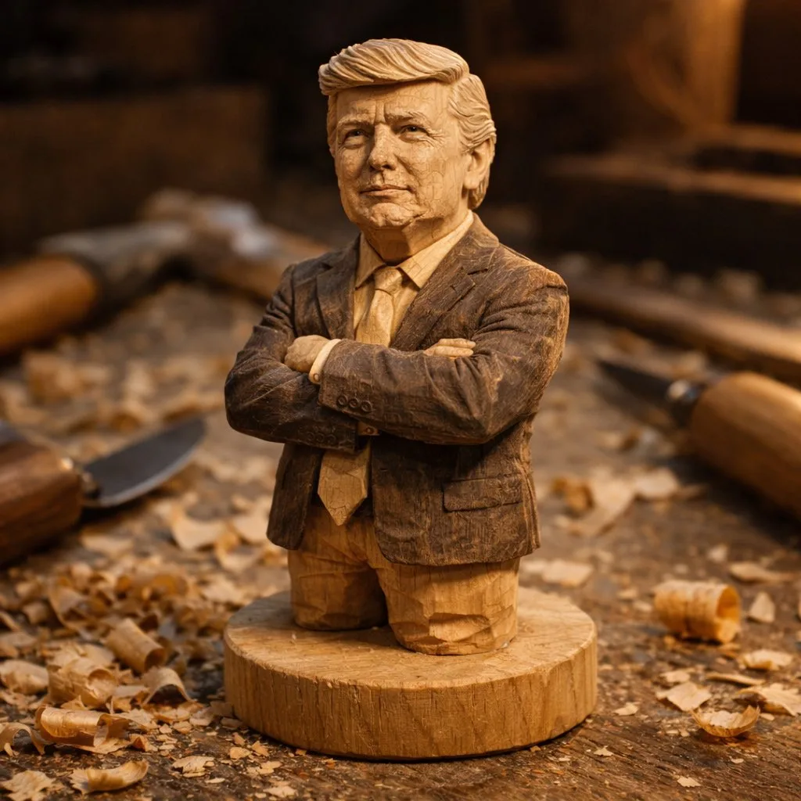

# Duet | AI — by @Sheldon056

[← Back to Community Examples](../../EXAMPLES.md) · Category: Illustration & 3D · Model: `GPT Image`

<a href="https://x.com/Sheldon056/status/2017886103781490917"></a>

Source: **[@Sheldon056 on X](https://x.com/Sheldon056/status/2017886103781490917)** · Creator: [Duet | AI](https://x.com/Sheldon056)

## Prompt

```text
A hand-carved wooden miniature figure of [NAME], shaped with visible knife marks, natural grain texture, and smooth unfinished edges. Placed on a workshop table with carving tools, wood shavings, and soft warm directional lighting. 1080×1080.
```

## Try it

Paste the prompt into **[vinano.ai](https://vinano.ai?utm_source=github&utm_medium=readme&utm_campaign=awesome-image-video-prompts-updating&utm_content=x-page-try)** to generate your own version.

> The image and prompt belong to @Sheldon056 ([original post](https://x.com/Sheldon056/status/2017886103781490917)) and are shown here with credit for reference. Creators can ask for changes or removal by opening an issue.
