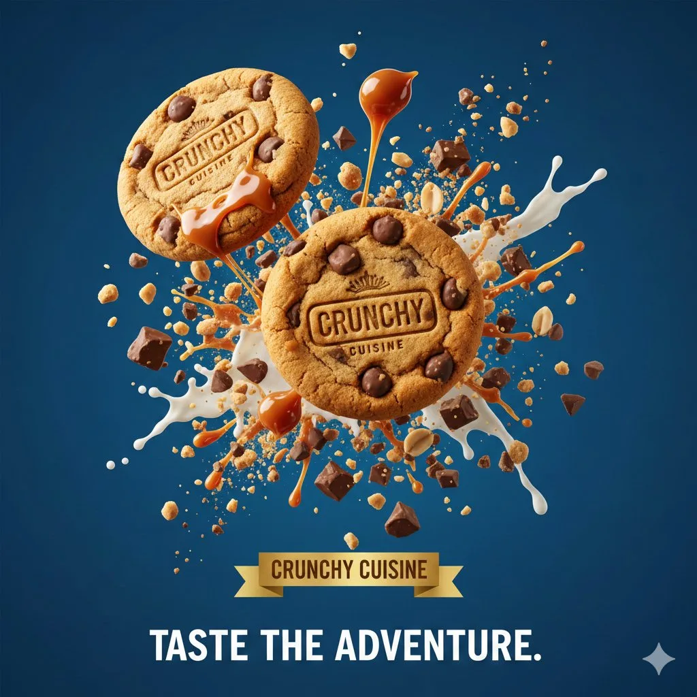

# Meem — by @mehvishs25

[← Back to Examples from X](../../EXAMPLES.md) · Category: Food & Drink · Model: `GPT Image`

<a href="https://x.com/mehvishs25/status/2019457811370164329"></a>

Original post: **[@mehvishs25 on X](https://x.com/mehvishs25/status/2019457811370164329)** · Creator: [Meem](https://x.com/mehvishs25)

## Prompt

```text
{
  "global_settings": {
    "resolution": "8K ultra-high-definition",
    "aspect_ratio": "3:4 vertical",
    "render_style": "hyper-realistic commercial food photography",
    "quality": "premium advertising grade",
    "sharpness": "extreme micro-detail, crisp edges",
    "noise": "none",
    "artifacts": "none",
    "depth_of_field": "shallow, subject-focused",
    "motion": "frozen mid-air ingredients",
    "background_style": "solid single-color studio backdrop"
  },

  "subject": {
    "main_food": "chocolate chip cookies",
    "quantity": 3,
    "appearance": [
      "golden-brown freshly baked cookies",
      "soft cracked surface",
      "visible melted chocolate chips",
      "slightly crisp edges",
      "natural handmade texture"
    ],
    "branding_rules": [
      "no text",
      "no logo",
      "no embossing",
      "no patterns",
      "no symbols"
    ]
  },

  "secondary_elements": {
    "ingredients_flying": [
      "dark chocolate chunks",
      "cookie crumbs",
      "fine sugar crystals"
    ],
    "motion_style": "dynamic floating explosion",
    "distribution": "balanced around the cookies, natural randomness",
    "particle_detail": "sharp, frozen motion with depth separation"
  },

  "composition": {
    "camera_angle": "slightly low angle",
    "framing": "center-weighted hero composition",
    "spacing": "clean negative space around subject",
    "focus_priority": "front cookie in razor-sharp focus"
  },

  "lighting": {
    "type": "professional studio lighting",
    "key_light": "soft directional key light",
    "fill_light": "gentle fill for texture clarity",
    "rim_light": "subtle rim highlight for separation",
    "shadows": "soft and natural, no harsh contrast"
  },

  "color_palette": {
    "background_color": "pastel blue",
    "cookie_tones": "warm golden browns",
    "accent_colors": "rich chocolate browns, crystal sugar whites",
    "contrast": "high subject-background separation"
  },

  "photography_style": {
    "genre": "luxury food advertising",
    "mood": "fresh, indulgent, premium",
    "cleanliness": "spotless studio look",
    "post_processing": "minimal, natural, high-end retouching"
  },

  "exclusions": [
    "text",
    "logos",
    "watermarks",
    "hands",
    "plates",
    "props",
    "packaging",
    "background objects",
    "cartoon style",
    "illustration style"
  ]
}
```

## Try it

Paste the prompt into **[vinano.ai](https://vinano.ai?utm_source=github&utm_medium=readme&utm_campaign=awesome-image-video-prompts-updating&utm_content=x-page-try)** to generate your own version.

> The image and prompt belong to [@mehvishs25](https://x.com/mehvishs25) and are shown here with credit for reference. Creators can ask for changes or removal by opening an issue.
