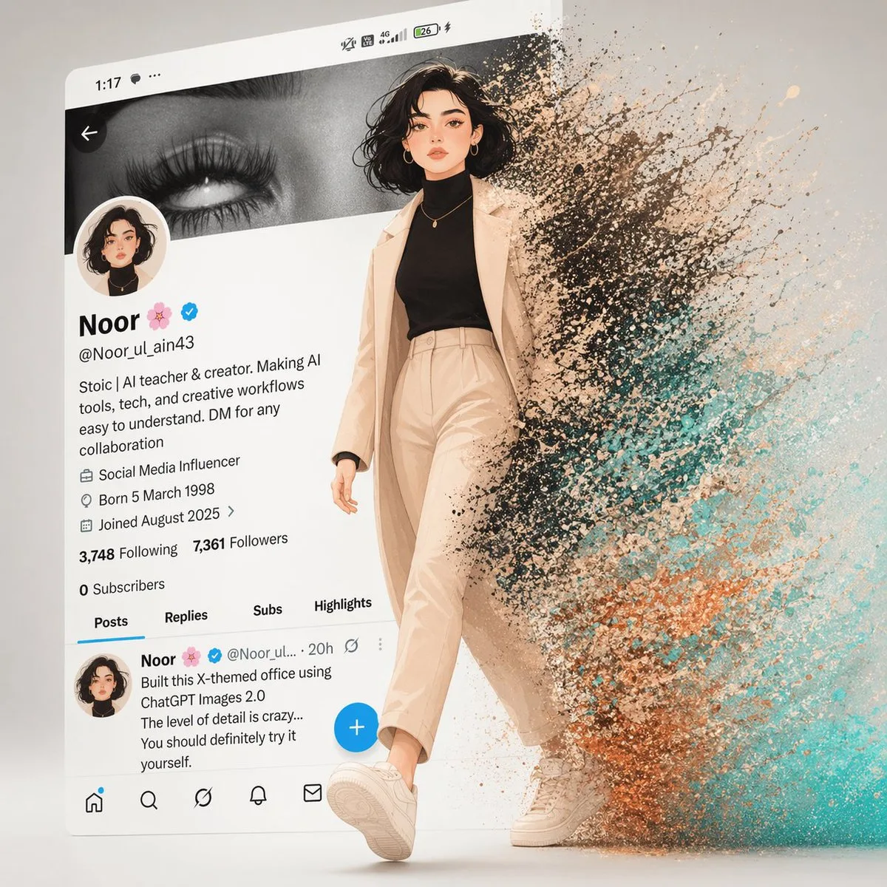

# Noor 🌸 — by @Noor_ul_ain43

[← Back to Community Examples](../../EXAMPLES.md) · Category: UI & Graphic · Model: `GPT Image`

<a href="https://x.com/Noor_ul_ain43/status/2047227731839184901"></a>

Source: **[@Noor_ul_ain43 on X](https://x.com/Noor_ul_ain43/status/2047227731839184901)** · Creator: [Noor 🌸](https://x.com/Noor_ul_ain43)

## Prompt

```text
A cinematic digital artwork of a stylish animated girl walking out of a modern X (Twitter) profile interface. The background shows a real mobile UI profile screen with the name "Noor 🌸", verified badge, username @Noor_ul_ain43, and detailed bio.
The girl matches the profile picture — soft aesthetic illustration style, short wavy black hair, gold hoop earrings, minimal makeup, wearing a black turtleneck and beige coat with matching pants and sneakers.
She is stepping forward confidently from the screen into real space. The right half of her body dissolves into dynamic particles — a mix of black dust, teal, and orange energy splashes, flowing outward like liquid + digital fragments.
Clean composition: left side = structured UI, right side = abstract particle explosion. Soft cinematic lighting, depth of field, ultra-detailed textures, smooth shadows, 4K render, octane render, Unreal Engine 5 style, trending on ArtStation.
```

## Try it

Paste the prompt into **[vinano.ai](https://vinano.ai?utm_source=github&utm_medium=readme&utm_campaign=awesome-image-video-prompts-updating&utm_content=x-page-try)** to generate your own version.

> The image and prompt belong to @Noor_ul_ain43 ([original post](https://x.com/Noor_ul_ain43/status/2047227731839184901)) and are shown here with credit for reference. Creators can ask for changes or removal by opening an issue.
