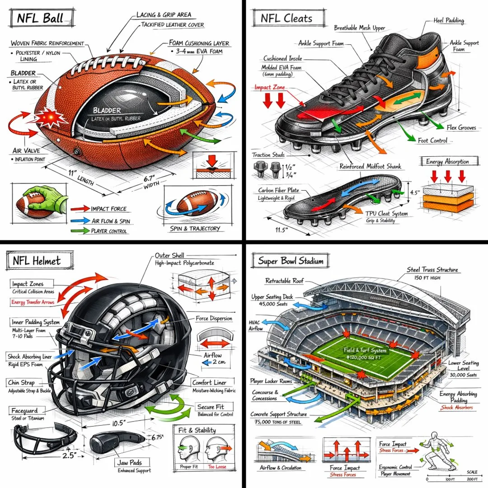

# TechieSA — by @TechieBySA

[← Back to Community Examples](../../EXAMPLES.md) · Category: Illustration & 3D · Model: `GPT Image`

<a href="https://x.com/TechieBySA/status/2019103270447505848"></a>

Source: **[@TechieBySA on X](https://x.com/TechieBySA/status/2019103270447505848)** · Creator: [TechieSA](https://x.com/TechieBySA)

## Prompt

```text
Create a technical infographic of [OBJECT] with a 45-degree isometric 3D perspective, slightly tilted to reveal depth, structure, and internal construction.

Combine a realistic photoreal render with black ink technical annotations on a pure white background. Include:
• Key component labels with clean callout boxes
• Internal structure visibility through cutaway or exploded sections
• Measurements, dimensions, and scale markers
• Material callouts and quantities
• Color-coded arrows indicating functional systems:
•RED: impact force, collision zones, stress points
•BLUE: airflow, spin, grip interaction, movement dynamics
•GREEN: player control, handling, ergonomics
•ORANGE: padding, reinforcement, energy absorption

Include simple sectional diagrams or force-flow schematics where relevant.

Place the title “[OBJECT]” inside a hand-drawn technical annotation box in the top-left corner.

Style:
Black ink technical linework (architectural / engineering manual style), precise but slightly hand-sketched. The object remains clearly visible beneath annotations. Clean, museum-exhibit / sports engineering vibe.

Perspective:
Isometric 3D angle emphasizing depth, form, and internal architecture — like a professional equipment teardown.

Color palette:
White background, black linework with ~10–15% accent color usage (functional arrows only).

Output:
1080×1080, ultra-crisp, social-feed optimized, no watermark.
```

## Try it

Paste the prompt into **[vinano.ai](https://vinano.ai?utm_source=github&utm_medium=readme&utm_campaign=awesome-image-video-prompts-updating&utm_content=x-page-try)** to generate your own version.

> The image and prompt belong to @TechieBySA ([original post](https://x.com/TechieBySA/status/2019103270447505848)) and are shown here with credit for reference. Creators can ask for changes or removal by opening an issue.
