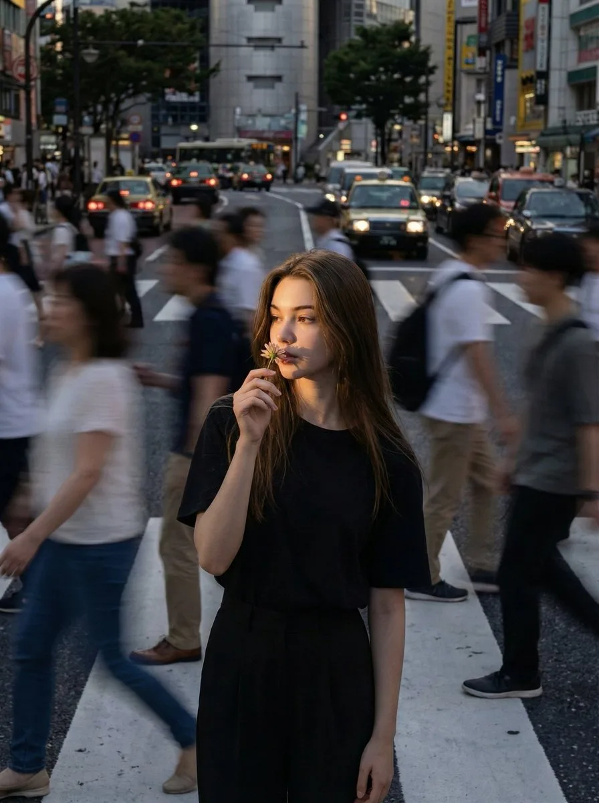

# 𝗦𝗮𝗻𝗶𝗮 — by @saniaspeaks_

[← Back to Examples from X](../../EXAMPLES.md) · Category: Photography · Model: `GPT Image`

<a href="https://x.com/saniaspeaks_/status/2003500034239938642"></a>

Original post: **[@saniaspeaks_ on X](https://x.com/saniaspeaks_/status/2003500034239938642)** · Creator: [𝗦𝗮𝗻𝗶𝗮](https://x.com/saniaspeaks_)

## Prompt

```text
{
  "type": "image_generation_prompt",
  "style": "photorealistic cinematic street photography, documentary aesthetic",
  "resolution": "ultra-high resolution",
  "identity_preservation": {
    "use_reference_image": true,
    "alter_face": false,
    "strict_identity_lock": true,
    "notes": "Use the uploaded reference image as the compositional base. Replace the central character with the woman from the reference image, preserving exact facial structure, skin texture, lighting direction, shadows, depth of field, angle, and emotional expression. No distortions, no artifacts, no skin tone mismatch."
  },
  "subject": {
    "gender": "female",
    "appearance": {
      "hair": "bald (as in the original composition)",
      "age": "adult",
      "expression": "calm, introspective, emotionally neutral",
      "skin": "realistic texture with natural pores and tones"
    },
    "pose": {
      "position": "standing still in the center of a busy urban crosswalk",
      "action": "gently smelling a flower held near the face",
      "posture": "upright, relaxed, perfectly static"
    },
    "wardrobe": {
      "outerwear": "dark minimalist blazer",
      "top": "black shirt"
    }
  },
  "environment": {
    "location": "busy urban pedestrian crosswalk",
    "atmosphere": "metropolitan street scene",
    "crowd": {
      "behavior": "people moving rapidly around the subject",
      "effect": "motion blur from long exposure"
    }
  },
  "lighting": {
    "type": "natural daylight",
    "conditions": "overcast sky",
    "quality": "soft, diffused light",
    "effects": [
      "realistic skin tones",
      "no artificial highlights",
      "natural shadows"
    ]
  },
  "cinematic_effects": {
    "long_exposure": true,
    "subject_clarity": "central subject perfectly sharp",
    "surroundings": "crowd blurred with motion",
    "mood": "isolation and stillness amid chaos"
  },
  "color_grading": {
    "palette": [
      "cool grays",
      "muted browns",
      "soft blacks"
    ],
    "saturation": "desaturated",
    "style": "professional cinematic grading"
  },
  "camera": {
    "lens_look": "85mm",
    "depth_of_field": "shallow",
    "grain": "realistic film grain",
    "perspective": "identical to original reference image"
  },
  "quality_constraints": [
    "no facial deformation",
    "no AI artifacts",
    "no artificial lighting effects",
    "perfect facial integration",
    "consistent shadows and perspective"
  ],
  "output_goal": "Create a photorealistic, cinematic street photograph featuring a woman standing still in a busy crosswalk, smelling a flower, with long-exposure motion blur around her, preserving the exact realism, lighting, depth, and emotional tone of the original reference image."
}
```

## Try it

Paste the prompt into **[vinano.ai](https://vinano.ai?utm_source=github&utm_medium=readme&utm_campaign=awesome-image-video-prompts-updating&utm_content=x-page-try)** to generate your own version.

> The image and prompt belong to [@saniaspeaks_](https://x.com/saniaspeaks_) and are shown here with credit for reference. Creators can ask for changes or removal by opening an issue.
