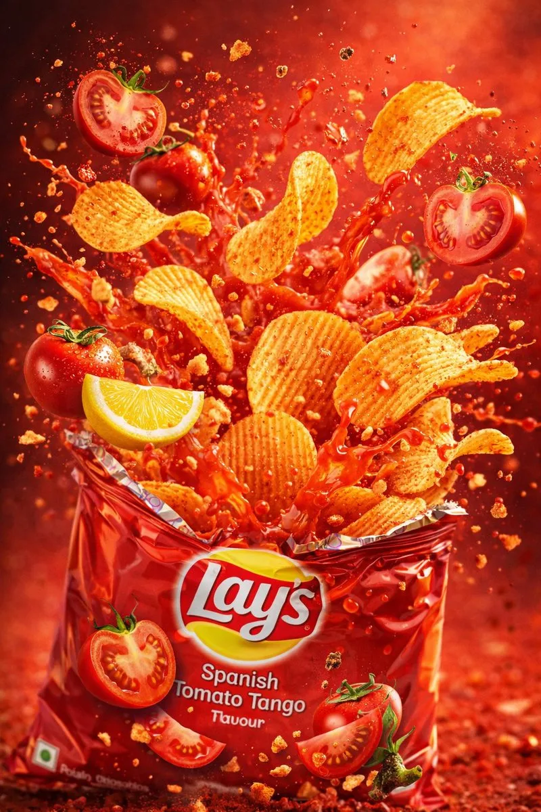

# ShaHid WaNii — by @meng_dagg695

[← Back to Examples from X](../../EXAMPLES.md) · Category: Food & Drink · Model: `GPT Image`

<a href="https://x.com/meng_dagg695/status/2007635164718084527"></a>

Original post: **[@meng_dagg695 on X](https://x.com/meng_dagg695/status/2007635164718084527)** · Creator: [ShaHid WaNii](https://x.com/meng_dagg695)

## Prompt

```text
{
  "prompt_name": "Lays_Spanish_Tomato_Tango_Explosion",
  "description": "Ultra-realistic commercial food photography showing a red Lay’s snack packet torn open from the top, positioned at the bottom center of the frame. Golden ridged potato chips are explosively bursting upward in frozen mid-air motion. Thick red tomato sauce splashes dynamically around the chips, forming arcs and droplets. Fresh whole tomatoes and halved tomatoes with visible seeds are flying around. Small crispy crumbs and seasoning particles are suspended in the air. The Lay’s logo is clearly visible on the packet, with readable text: 'Spanish Tomato Tango Flavour'. The packet surface is glossy and reflective with realistic wrinkles. Background is a deep red gradient filled with floating sauce droplets and particles, creating intense energy.",
  "lighting": "Dramatic warm studio lighting with strong highlights, deep shadows, and high contrast",
  "color_palette": ["deep red", "tomato red", "golden yellow", "dark orange"],
  "motion": "High-energy explosive upward motion with frozen splashes and flying fragments",
  "focus": "Ultra-sharp focus on chips, sauce splashes, and packet branding",
  "texture_detail": "Highly detailed ridged chip texture, glossy liquid splashes, realistic foil reflections",
  "style": "Premium FMCG commercial advertising, cinematic realism",
  "resolution": "8K",
  "aspect_ratio": "3:4"
}
```

## Try it

Paste the prompt into **[vinano.ai](https://vinano.ai?utm_source=github&utm_medium=readme&utm_campaign=awesome-image-video-prompts-updating&utm_content=x-page-try)** to generate your own version.

> The image and prompt belong to [@meng_dagg695](https://x.com/meng_dagg695) and are shown here with credit for reference. Creators can ask for changes or removal by opening an issue.
