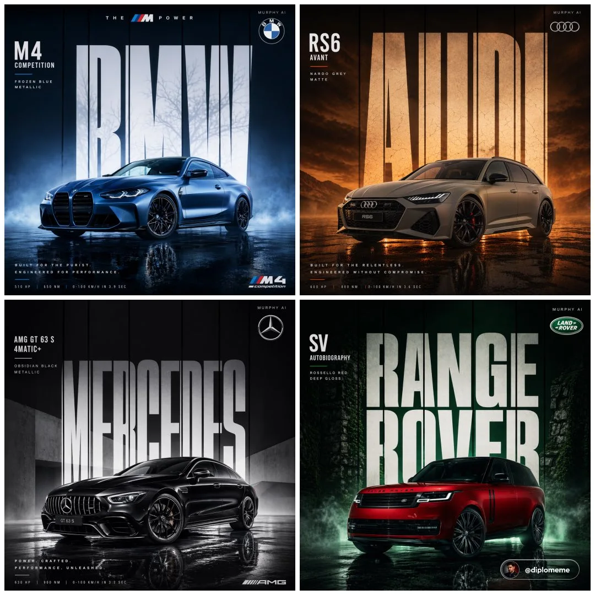

# ᴍᴜʀᴘʜʏ — by @Diplomeme

[← Back to Community Examples](../../EXAMPLES.md) · Category: Poster Design · Model: `GPT Image`

<a href="https://x.com/Diplomeme/status/2045830975318610408"></a>

Source: **[@Diplomeme on X](https://x.com/Diplomeme/status/2045830975318610408)** · Creator: [ᴍᴜʀᴘʜʏ](https://x.com/Diplomeme)

## Prompt

```text
Cinematic automotive billboard poster, [CAR MODEL + VARIANT] in [PAINT COLOR + FINISH], parked center-frame, dominant stance, [CAMERA ANGLE — e.g. low angle / front three-quarter / elevated SUV angle], ultra controlled composition

dramatic studio lighting setup with [PRIMARY LIGHT COLOR/TONE] key light, [RIM LIGHT COLOR] rim lighting defining silhouette, high contrast shadow falloff, precise specular highlights across body panels

massive billboard-style typography composition, bold condensed sans-serif white text "[BRAND NAME]" filling entire background wall behind the car, perfectly centered and spanning edge-to-edge, with thin vertical dark lines slicing through each letter evenly, consistent spacing, no distortion

environment designed to match brand mood: [ENVIRONMENT DESCRIPTION — e.g. minimal concrete / desert haze / forest stone / industrial steel], seamlessly fading into deep gradient background, zero clutter

ground surface: [SURFACE TYPE — wet asphalt / gloss studio floor / textured terrain] with subtle realistic reflections, controlled diffusion, no noise

atmosphere: [FOG / HAZE / PARTICLES — optional but controlled], only at ground level for depth

top right corner: [BRAND LOGO DESCRIPTION], small and elegant, paired with minimal uppercase text "[YOUR SIGNATURE — e.g. MURPHY AI]" aligned cleanly

STRICT RULES:
— no extra taglines  
— no performance specs  
— no additional typography  
— no random elements  
— maintain premium minimal billboard aesthetic  

render quality: hyper-detailed photorealism, ultra sharp reflections, realistic paint microtexture, cinematic color grade matching environment

composition: perfectly balanced, symmetrical, professional automotive advertising layout

format: 1:1 square, ultra high resolution, print-ready billboard finish
```

## Try it

Paste the prompt into **[vinano.ai](https://vinano.ai?utm_source=github&utm_medium=readme&utm_campaign=awesome-image-video-prompts-updating&utm_content=x-page-try)** to generate your own version.

> The image and prompt belong to @Diplomeme ([original post](https://x.com/Diplomeme/status/2045830975318610408)) and are shown here with credit for reference. Creators can ask for changes or removal by opening an issue.
