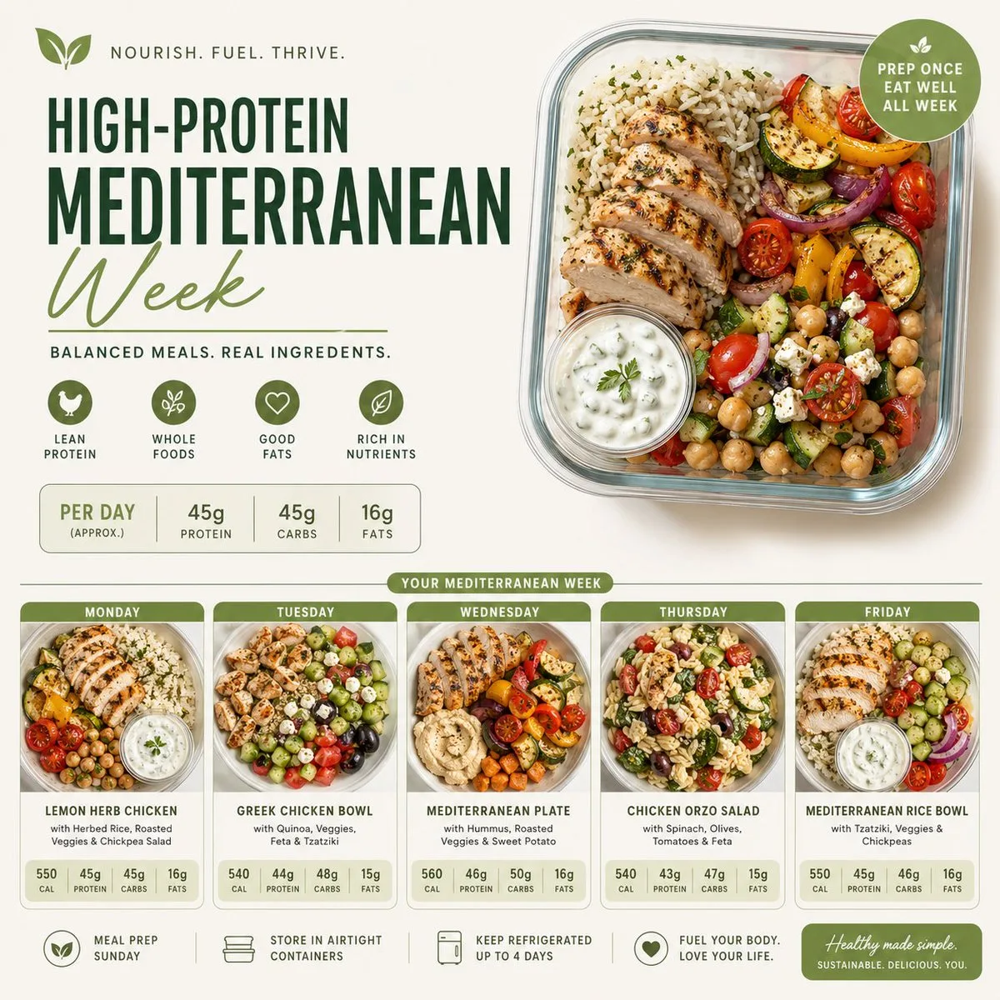

# Dheepan Ratnam — by @Dheepanratnam

[← Back to Community Examples](../../EXAMPLES.md) · Category: Food & Drink · Model: `GPT Image`

<a href="https://x.com/Dheepanratnam/status/2048076798798217594"></a>

Source: **[@Dheepanratnam on X](https://x.com/Dheepanratnam/status/2048076798798217594)** · Creator: [Dheepan Ratnam](https://x.com/Dheepanratnam)

## Prompt

```text
Clean & appetizing meal prep layouts

Design a minimalist healthy meal prep poster for [MEAL PLAN], with clean containers, colorful balanced ingredients, calorie/macros panel, weekly layout, soft pastel background, bright natural light, wellness brand typography, crisp shadows, modern Instagram design.
```

## Try it

Paste the prompt into **[vinano.ai](https://vinano.ai?utm_source=github&utm_medium=readme&utm_campaign=awesome-image-video-prompts-updating&utm_content=x-page-try)** to generate your own version.

> The image and prompt belong to @Dheepanratnam ([original post](https://x.com/Dheepanratnam/status/2048076798798217594)) and are shown here with credit for reference. Creators can ask for changes or removal by opening an issue.
