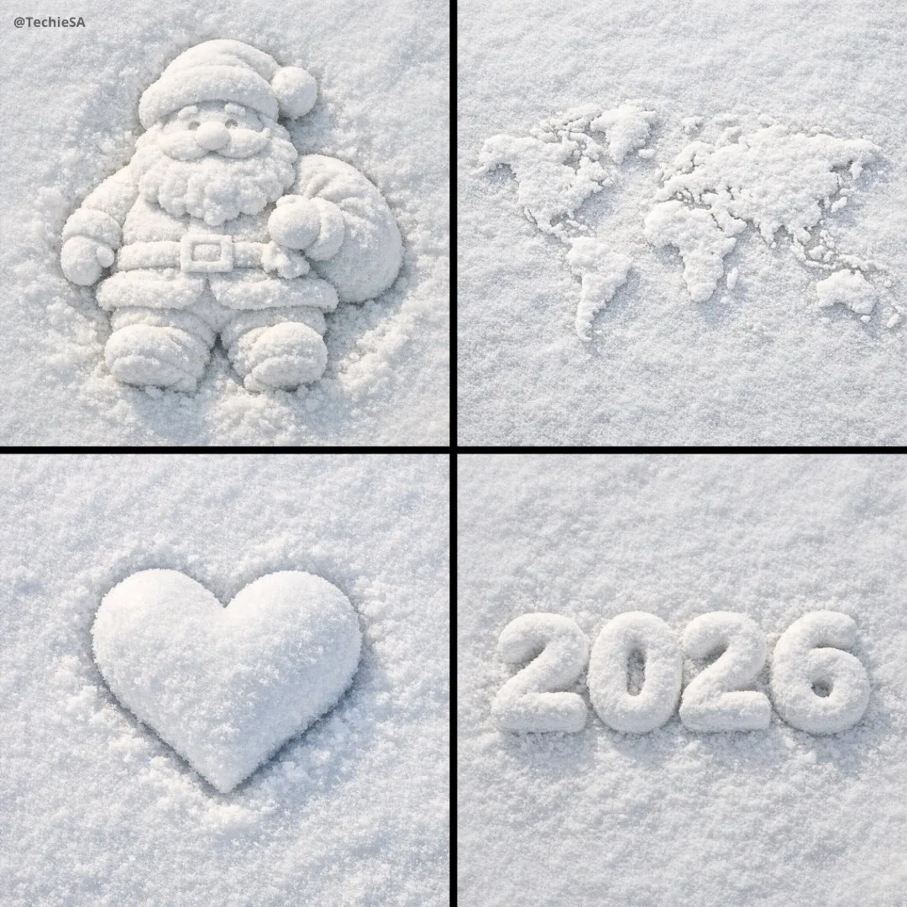

# TechieSA — by @TechieBySA

[← Back to Community Examples](../../EXAMPLES.md) · Category: Illustration & 3D · Model: `GPT Image`

<a href="https://x.com/TechieBySA/status/2004259040491409514"></a>

Source: **[@TechieBySA on X](https://x.com/TechieBySA/status/2004259040491409514)** · Creator: [TechieSA](https://x.com/TechieBySA)

## Prompt

```text
Create a 3D of [OBJECT] made of white snow. The voluminous are lying on a snowy surface, slightly sunken into the snow. Top-down view. A photo with realistic highlights and soft shadows. 1080x1080 dimension picture.
```

## Try it

Paste the prompt into **[vinano.ai](https://vinano.ai?utm_source=github&utm_medium=readme&utm_campaign=awesome-image-video-prompts-updating&utm_content=x-page-try)** to generate your own version.

> The image and prompt belong to @TechieBySA ([original post](https://x.com/TechieBySA/status/2004259040491409514)) and are shown here with credit for reference. Creators can ask for changes or removal by opening an issue.
