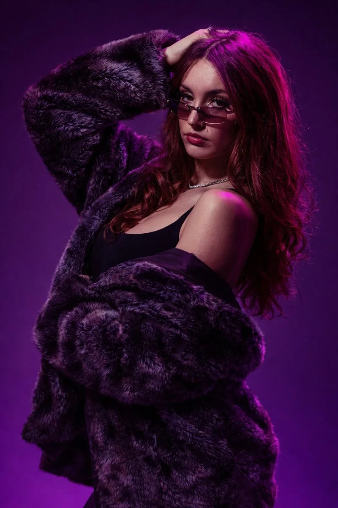

# ShaHid WaNii — by @meng_dagg695

[← Back to Examples from X](../../EXAMPLES.md) · Category: Photography · Model: `GPT Image`

<a href="https://x.com/meng_dagg695/status/2003650158064730620"></a>

Original post: **[@meng_dagg695 on X](https://x.com/meng_dagg695/status/2003650158064730620)** · Creator: [ShaHid WaNii](https://x.com/meng_dagg695)

## Prompt

```text
{
  "image_type": "studio fashion portrait photography",
  "resolution_target": "8K ultra high definition",
  "aspect_ratio": "portrait (vertical)",
  "composition": {
    "framing": "medium portrait",
    "crop": "head to mid-torso",
    "subject_position": "slightly right of center",
    "camera_angle": "eye-level",
    "pose": {
      "body_orientation": "three-quarter turn to the left",
      "head_orientation": "turned toward camera",
      "arm_position": "one arm raised with hand placed behind or on top of head, other arm lowered and relaxed"
    }
  },
  "subject": {
    "gender_presentation": "female",
    "age_range": "young adult",
    "skin_tone": "light to medium",
    "facial_expression": {
      "expression": "neutral to mildly serious",
      "gaze_direction": "directly at camera",
      "emotion": "confident, composed"
    },
    "face_details": {
      "face_shape": "oval",
      "complexion": "smooth, even",
      "makeup": {
        "eyes": "defined eyeliner and mascara",
        "lips": "deep muted red or berry tone lipstick",
        "overall": "moderate, polished makeup"
      },
      "piercings": [
        "small nose ring on left nostril"
      ]
    },
    "eyes": {
      "visibility": "partially visible through tinted glasses",
      "eyewear": {
        "type": "narrow rectangular sunglasses",
        "lens_color": "dark tinted",
        "frame": "thin metal frame",
        "position": "worn low on the bridge of the nose"
      }
    },
    "hair": {
      "color": "medium brown with strong magenta/purple lighting highlights",
      "length": "long",
      "style": "loose, softly wavy",
      "parting": "center part"
    }
  },
  "clothing_and_accessories": {
    "outerwear": {
      "type": "faux fur coat",
      "color": "dark gray to black",
      "texture": "thick, plush, high-volume fur",
      "fit": "oversized",
      "wearing_style": "draped loosely off the shoulders"
    },
    "inner_clothing": {
      "type": "sleeveless top",
      "color": "black",
      "neckline": "straight or slightly scooped"
    },
    "jewelry": {
      "necklace": {
        "type": "thin chain necklace",
        "material": "metallic",
        "visibility": "clearly visible at collarbone"
      }
    }
  },
  "lighting": {
    "style": "studio lighting",
    "primary_light": {
      "direction": "front-left",
      "quality": "soft but directional"
    },
    "accent_lighting": {
      "color": "magenta/purple",
      "placement": "from above and behind, especially on hair and shoulders"
    },
    "contrast": "medium to high",
    "shadow_detail": "soft shadows with smooth falloff"
  },
  "background": {
    "type": "studio backdrop",
    "color": "deep purple gradient",
    "texture": "smooth, seamless",
    "depth": "no visible background objects"
  },
  "color_palette": {
    "dominant_colors": [
      "purple",
      "magenta",
      "black",
      "dark gray"
    ],
    "accent_colors": [
      "skin tones",
      "metallic silver"
    ]
  },
  "image_quality": {
    "sharpness": "high",
    "detail_level": "very high",
    "noise": "minimal to none",
    "dynamic_range": "wide"
  },
  "overall_style": {
    "aesthetic": "fashion editorial",
    "mood": "moody, stylish, confident",
    "era_influence": "modern"
  }
}
```

## Try it

Paste the prompt into **[vinano.ai](https://vinano.ai?utm_source=github&utm_medium=readme&utm_campaign=awesome-image-video-prompts-updating&utm_content=x-page-try)** to generate your own version.

> The image and prompt belong to [@meng_dagg695](https://x.com/meng_dagg695) and are shown here with credit for reference. Creators can ask for changes or removal by opening an issue.
