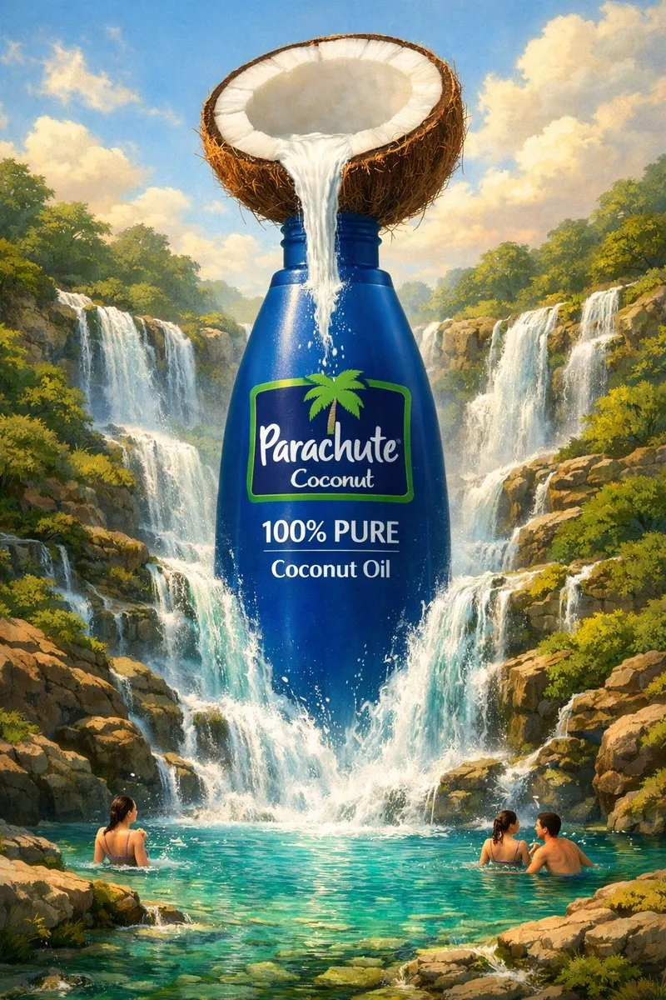

# ShaHid WaNii — by @meng_dagg695

[← Back to Examples from X](../../EXAMPLES.md) · Category: Product & Brand · Model: `GPT Image`

<a href="https://x.com/meng_dagg695/status/2008878369107276184"></a>

Original post: **[@meng_dagg695 on X](https://x.com/meng_dagg695/status/2008878369107276184)** · Creator: [ShaHid WaNii](https://x.com/meng_dagg695)

## Prompt

```text
Surreal premium commercial illustration for [BRAND NAME] [OIL TYPE], featuring the product bottle embedded into a massive natural landscape made entirely from the core ingredient. The ingredient appears at the top source, flowing as a natural element into the bottle, then transforming into waterfalls, rivers, or pools below. The environment, terrain, vegetation, textures, and color palette are all inspired by [PRIMARY INGREDIENT]. Small human figures interact naturally with the environment to emphasize scale. Cinematic lighting, soft painterly realism, ultra-detailed textures, fantasy-meets-nature aesthetic, vertical poster composition, 8K ultra-high resolution.
```

## Try it

Paste the prompt into **[vinano.ai](https://vinano.ai?utm_source=github&utm_medium=readme&utm_campaign=awesome-image-video-prompts-updating&utm_content=x-page-try)** to generate your own version.

> The image and prompt belong to [@meng_dagg695](https://x.com/meng_dagg695) and are shown here with credit for reference. Creators can ask for changes or removal by opening an issue.
