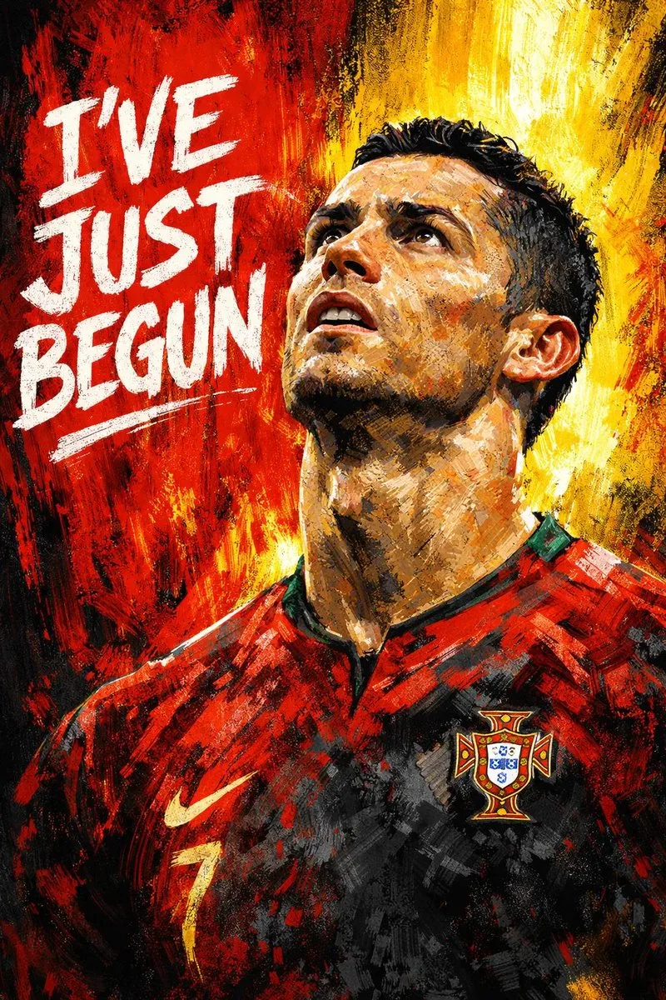

# simeon-sanai — by @Naiknelofar788

[← Back to Community Examples](../../EXAMPLES.md) · Category: Photography · Model: `GPT Image`

<a href="https://x.com/Naiknelofar788/status/2024432382124945823"></a>

Source: **[@Naiknelofar788 on X](https://x.com/Naiknelofar788/status/2024432382124945823)** · Creator: [simeon-sanai](https://x.com/Naiknelofar788)

## Prompt

```text
Create a dramatic, digital painting-style portrait of a male footballer looking upwards with a determined expression. The style should be bold and textured, using dynamic brushstrokes and a limited color palette mainly black, white, red, and yellow. The background should be split vertically with abstract red and yellow paint streaks. On the red side, include the bold motivational text ‘I’VE JUST BEGUN’ in large white, hand-painted font. Capture the intensity and ambition in the player’s gaze. The composition should feel motivational and powerful, ideal for a sports poster. 8k Resolution, Image Aspect Ratio 4:5."
```

## Try it

Paste the prompt into **[vinano.ai](https://vinano.ai?utm_source=github&utm_medium=readme&utm_campaign=awesome-image-video-prompts-updating&utm_content=x-page-try)** to generate your own version.

> The image and prompt belong to @Naiknelofar788 ([original post](https://x.com/Naiknelofar788/status/2024432382124945823)) and are shown here with credit for reference. Creators can ask for changes or removal by opening an issue.
