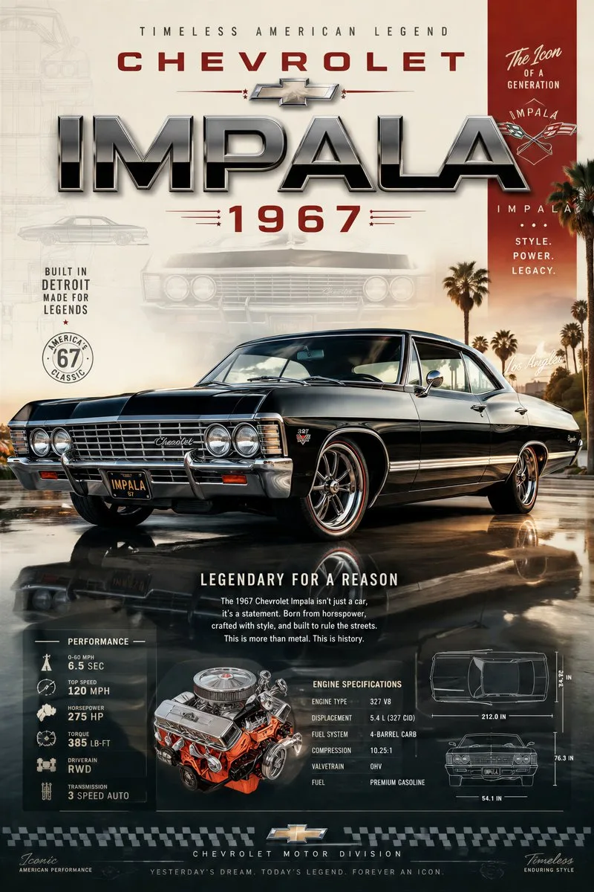

# Marcio Lima 利真 マルシオ 💎 — by @Preda2005

[← Back to Community Examples](../../EXAMPLES.md) · Category: Poster Design · Model: `GPT Image`

<a href="https://x.com/Preda2005/status/2048752153343545390"></a>

Source: **[@Preda2005 on X](https://x.com/Preda2005/status/2048752153343545390)** · Creator: [Marcio Lima 利真 マルシオ 💎](https://x.com/Preda2005)

## Prompt

```text
Create an epic premium automotive poster of 
[CAR MODEL].

Place the car as the heroic central subject in a dynamic three-quarter side profile, visually dominant and impossible to ignore.

Show the full beauty of the vehicle with aggressive stance, perfect proportions, premium wheels, signature headlights, aerodynamic lines, spoilers, performance details, and luxury design language.

Add bold premium typography with the brand name, model name, performance stats, horsepower, acceleration, top speed, engine specs, and iconic achievements beautifully integrated into the composition.

Include subtle background elements inspired by the car’s heritage: faded blueprint lines, racing legacy, silhouette overlays, iconic tracks, engineering details, speed graphics, and collector-poster aesthetics.

Use strong visual contrast, bright premium colors (avoid dark black-heavy backgrounds), cinematic lighting, ultra-detailed reflections, glossy paint finish, luxury magazine quality, modern graphic design, and scroll-stopping masterpiece energy.

Clean composition, high-end automotive advertisement style, collector poster aesthetic, highly detailed, visually powerful, premium masterpiece.
```

## Try it

Paste the prompt into **[vinano.ai](https://vinano.ai?utm_source=github&utm_medium=readme&utm_campaign=awesome-image-video-prompts-updating&utm_content=x-page-try)** to generate your own version.

> The image and prompt belong to @Preda2005 ([original post](https://x.com/Preda2005/status/2048752153343545390)) and are shown here with credit for reference. Creators can ask for changes or removal by opening an issue.
