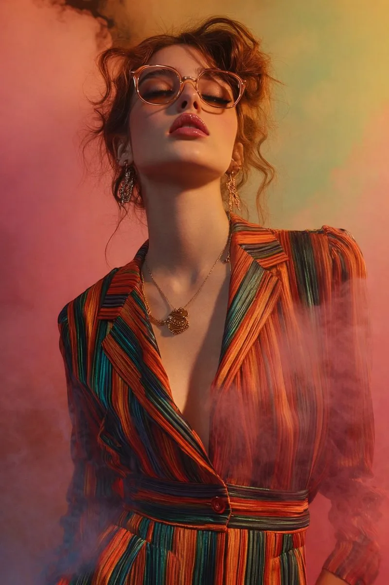

# ShaHid WaNii — by @meng_dagg695

[← Back to Examples from X](../../EXAMPLES.md) · Category: Photography · Model: `GPT Image`

<a href="https://x.com/meng_dagg695/status/2003730339542499635"></a>

Original post: **[@meng_dagg695 on X](https://x.com/meng_dagg695/status/2003730339542499635)** · Creator: [ShaHid WaNii](https://x.com/meng_dagg695)

## Prompt

```text
{
  "image_type": "fashion portrait photography",
  "resolution_target": "8K Ultra HD",
  "aspect_ratio": "vertical (portrait)",
  "composition": {
    "framing": "medium close-up portrait",
    "crop": "from upper chest to slightly above head",
    "subject_position": "centered",
    "camera_angle": "low angle, slightly upward-facing",
    "perspective": "dramatic upward perspective emphasizing neck and jawline",
    "depth_of_field": "shallow depth of field with soft background blur"
  },
  "subject": {
    "gender_presentation": "female-presenting",
    "age_range": "young adult",
    "skin_tone": "fair/light",
    "pose": {
      "head_position": "tilted slightly back",
      "chin": "raised upward",
      "shoulders": "relaxed, facing forward"
    },
    "facial_expression": {
      "eyes": "closed",
      "mouth": "slightly parted",
      "expression_mood": "calm, confident, introspective"
    },
    "face_details": {
      "face_shape": "oval",
      "jawline": "soft but defined",
      "cheekbones": "subtly defined",
      "skin_texture": "smooth, evenly lit"
    }
  },
  "hair": {
    "color": "reddish-brown / auburn",
    "length": "medium",
    "style": "loosely styled with soft waves",
    "texture": "slightly tousled",
    "flyaways": "visible loose strands around head and neck"
  },
  "eyewear": {
    "type": "eyeglasses",
    "frame_style": "rounded",
    "frame_material_appearance": "translucent",
    "frame_color": "light amber / peach-tinted",
    "lens": "clear"
  },
  "makeup": {
    "lip_color": "deep pink / rose",
    "lip_finish": "glossy",
    "eye_makeup": "subtle, warm-toned",
    "overall_style": "natural with emphasis on lips"
  },
  "accessories": {
    "earrings": {
      "type": "dangling earrings",
      "material_appearance": "metallic",
      "design": "intricate, elongated"
    },
    "necklace": {
      "type": "chain necklace",
      "pendant": "ornamental pendant",
      "material_appearance": "gold-toned metal"
    }
  },
  "clothing": {
    "garment_type": "tailored jacket or dress with lapels",
    "neckline": "deep V-neck",
    "fit": "structured yet flowing",
    "fabric_texture": "smooth, slightly reflective",
    "pattern": "vertical multicolored stripes",
    "colors": [
      "orange",
      "red",
      "green",
      "teal",
      "yellow"
    ],
    "buttons": "visible front button at mid-torso"
  },
  "lighting": {
    "type": "studio lighting",
    "direction": "soft frontal with slight side emphasis",
    "contrast": "moderate",
    "highlights": "gentle highlights on face and glasses",
    "shadows": "soft shadows under chin and neck"
  },
  "background": {
    "environment": "studio setup",
    "elements": "colored smoke or mist",
    "color_palette": [
      "pink",
      "coral",
      "peach",
      "soft green"
    ],
    "background_style": "abstract, atmospheric"
  },
  "atmosphere": {
    "mood": "cinematic, fashion-forward",
    "visual_effects": "floating colored smoke surrounding subject",
    "clarity": "subject sharp, background diffused"
  },
  "color_grading": {
    "tone": "warm",
    "saturation": "rich but balanced",
    "overall_palette": "harmonized warm and pastel tones"
  },
  "image_quality": {
    "sharpness": "high detail on facial features, clothing texture, accessories",
    "noise": "none visible",
    "finish": "clean, professional, editorial-grade"
  }
}
```

## Try it

Paste the prompt into **[vinano.ai](https://vinano.ai?utm_source=github&utm_medium=readme&utm_campaign=awesome-image-video-prompts-updating&utm_content=x-page-try)** to generate your own version.

> The image and prompt belong to [@meng_dagg695](https://x.com/meng_dagg695) and are shown here with credit for reference. Creators can ask for changes or removal by opening an issue.
