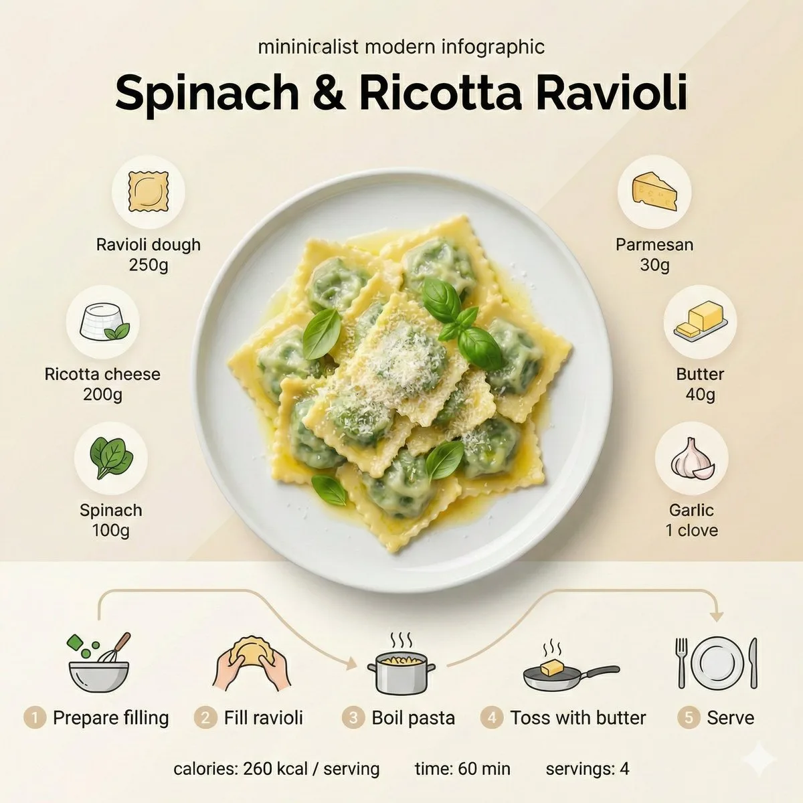

# Johnn — by @john_my07

[← Back to Community Examples](../../EXAMPLES.md) · Category: Food & Drink · Model: `GPT Image`

<a href="https://x.com/john_my07/status/2018899983752380850"></a>

Source: **[@john_my07 on X](https://x.com/john_my07/status/2018899983752380850)** · Creator: [Johnn](https://x.com/john_my07)

## Prompt

```text
{
  "style": "Minimalist modern recipe infographic",
  "visual_aesthetic": {
    "photography_style": "Top-down / 3-quarter angle food photography",
    "design_language": "Scandinavian, editorial cookbook layout",
    "background": "Soft neutral beige / cream",
    "lighting": "Soft diffused light with gentle shadows",
    "detail_level": "Ultra-realistic, ultra-sharp, 8K resolution"
  },
  "layout": {
    "composition": "Finished dish centered on a white ceramic plate or bowl",
    "elements": [
      "Floating ingredient icons in soft circular frames",
      "Clean vector-style ingredient illustrations",
      "Clear ingredient labels with quantities",
      "Curved step-by-step flow with numbered cooking icons"
    ],
    "typography": "High readability, modern sans-serif",
    "spacing": "Balanced, airy, uncluttered"
  },
  "recipes": [
    {
      "dish_name": "Traditional Polish Pierogi",
      "dish_presentation": "Golden boiled dumplings filled with potato and cheese, lightly buttered and garnished with fresh chives",
      "ingredients": [
        { "name": "All-purpose flour", "quantity": "2.5 cups" },
        { "name": "Potatoes", "quantity": "3 medium" },
        { "name": "Farmer cheese", "quantity": "200g" },
        { "name": "Onion", "quantity": "1 medium" },
        { "name": "Butter", "quantity": "40g" },
        { "name": "Salt", "quantity": "1 tsp" },
        { "name": "Water", "quantity": "0.75 cups" }
      ],
      "steps": [
        "Prepare dough",
        "Cook and mash filling",
        "Fill and shape pierogi",
        "Boil until tender",
        "Serve with butter"
      ],
      "meta": {
        "calories": "270 kcal / serving",
        "time": "70 min",
        "servings": 4
      }
    },
    {
      "dish_name": "Vinaigrette Salad",
      "dish_presentation": "Colorful diced vegetables mixed with light dressing, neatly molded and topped with fresh herbs",
      "ingredients": [
        { "name": "Beetroot", "quantity": "2 medium" },
        { "name": "Potatoes", "quantity": "2 medium" },
        { "name": "Carrots", "quantity": "1 medium" },
        { "name": "Pickled cucumbers", "quantity": "2 pcs" },
        { "name": "Green peas", "quantity": "1 cup" },
        { "name": "Sunflower oil", "quantity": "2 tbsp" },
        { "name": "Fresh dill", "quantity": "1 bunch" }
      ],
      "steps": [
        "Boil vegetables",
        "Cool and dice",
        "Mix ingredients",
        "Dress salad",
        "Chill and serve"
      ],
      "meta": {
        "calories": "180 kcal / serving",
        "time": "30 min + chill",
        "servings": 4
      }
    },
    {
      "dish_name": "Solyanka Soup",
      "dish_presentation": "Rich hearty soup with sliced meats, olives, lemon, and herbs, served steaming in a ceramic bowl",
      "ingredients": [
        { "name": "Mixed meats", "quantity": "400g" },
        { "name": "Onion", "quantity": "1 large" },
        { "name": "Pickles", "quantity": "3 pcs" },
        { "name": "Tomato paste", "quantity": "2 tbsp" },
        { "name": "Olives", "quantity": "1/2 cup" },
        { "name": "Garlic", "quantity": "2 cloves" },
        { "name": "Bay leaf", "quantity": "1 pc" },
        { "name": "Lemon", "quantity": "For serving" }
      ],
      "steps": [
        "Simmer broth",
        "Sauté aromatics",
        "Add meats and pickles",
        "Season and simmer",
        "Serve with lemon"
      ],
      "meta": {
        "calories": "320 kcal / serving",
        "time": "90 min",
        "servings": 5
      }
    }
  ]
}
```

## Try it

Paste the prompt into **[vinano.ai](https://vinano.ai?utm_source=github&utm_medium=readme&utm_campaign=awesome-image-video-prompts-updating&utm_content=x-page-try)** to generate your own version.

> The image and prompt belong to @john_my07 ([original post](https://x.com/john_my07/status/2018899983752380850)) and are shown here with credit for reference. Creators can ask for changes or removal by opening an issue.
