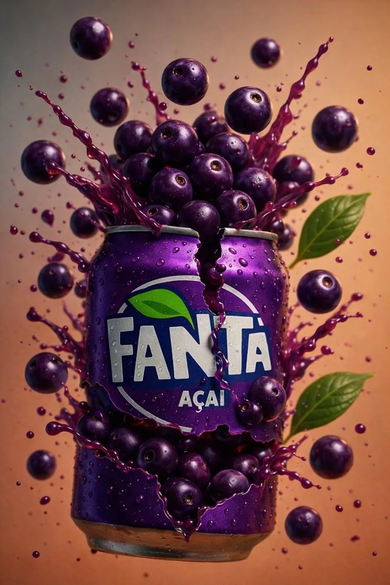

# ShaHid WaNii — by @meng_dagg695

[← Back to Examples from X](../../EXAMPLES.md) · Category: Food & Drink · Model: `GPT Image`

<a href="https://x.com/meng_dagg695/status/2009947657905811727"></a>

Original post: **[@meng_dagg695 on X](https://x.com/meng_dagg695/status/2009947657905811727)** · Creator: [ShaHid WaNii](https://x.com/meng_dagg695)

## Prompt

```text
{
  "global_settings": {
    "resolution": "8K UHD",
    "aspect_ratio": "3:4",
    "image_type": "AI-edited hyper-realistic commercial product photography",
    "camera": {
      "focus": "ultra-sharp center focus",
      "depth_of_field": "shallow DOF with soft background falloff",
      "angle": "straight-on frontal view",
      "lens": "macro-commercial lens look"
    },
    "lighting": {
      "style": "studio lighting",
      "key_light": "strong frontal soft light",
      "rim_light": "subtle edge highlights on fruits and splashes",
      "reflections": "specular highlights on liquid droplets and metal can"
    },
    "textures": [
      "highly detailed aluminum can surface",
      "realistic liquid physics",
      "sharp fruit skin texture",
      "visible condensation droplets"
    ],
    "quality_flags": [
      "extreme detail",
      "photorealistic",
      "AI-enhanced clarity",
      "no motion blur",
      "clean background"
    ]
  },

  "Module_1_Image_1_Style_Orange": {
    "subject": "Orange flavored soda can",
    "can_details": {
      "material": "metal aluminum",
      "condition": "top torn open with jagged sharp cracks",
      "crack_position": "irregular split at the top rim, metal bent outward",
      "surface": "covered with water droplets and condensation"
    },
    "fruit_elements": {
      "whole_oranges": "multiple whole oranges floating behind and above the can",
      "orange_slice": "one visible half-cut orange slice near the top center",
      "leaves": "green citrus leaves attached to some oranges"
    },
    "liquid_effects": {
      "splash_color": "bright orange liquid",
      "motion": "liquid bursting upward and outward from inside the can",
      "droplets": "numerous suspended droplets frozen mid-air",
      "base_splash": "orange liquid pooling and splashing at the bottom"
    },
    "background": {
      "color": "solid warm orange",
      "gradient": "slight tonal variation, no patterns"
    }
  },

  "Module_2_Image_2_Style_Acai": {
    "subject": "Açaí flavored soda can",
    "can_details": {
      "material": "metal aluminum",
      "condition": "can split horizontally into two broken sections",
      "cracks": "jagged tearing edges with visible sharp metal folds",
      "surface": "covered with condensation droplets"
    },
    "fruit_elements": {
      "acai_berries": "multiple dark purple berries erupting from inside the can",
      "berry_motion": "berries floating upward and outward",
      "leaves": "few green leaves visible on sides"
    },
    "liquid_effects": {
      "splash_color": "deep purple liquid",
      "motion": "explosive splash radiating outward",
      "droplets": "fine droplets suspended in air"
    },
    "background": {
      "color": "warm beige to light brown gradient",
      "tone": "soft neutral backdrop"
    }
  },

  "Module_3_Image_3_Style_Goiaba_Guava": {
    "subject": "Guava flavored soda can",
    "can_details": {
      "material": "metal aluminum",
      "condition": "vertical split down the center of the can",
      "cracks": "uneven torn edges exposing inside",
      "surface": "visible water droplets and moisture"
    },
    "fruit_elements": {
      "guava_halves": "multiple guava halves with pink interiors",
      "whole_guavas": "several whole green guavas around the can",
      "leaves": "green guava leaves scattered"
    },
    "liquid_effects": {
      "splash_color": "red guava juice",
      "motion": "juice bursting upward and sideways",
      "droplets": "dense red droplets suspended mid-air"
    },
    "background": {
      "color": "solid deep red",
      "tone": "high contrast with fruit and liquid"
    }
  }
```

## Try it

Paste the prompt into **[vinano.ai](https://vinano.ai?utm_source=github&utm_medium=readme&utm_campaign=awesome-image-video-prompts-updating&utm_content=x-page-try)** to generate your own version.

> The image and prompt belong to [@meng_dagg695](https://x.com/meng_dagg695) and are shown here with credit for reference. Creators can ask for changes or removal by opening an issue.
