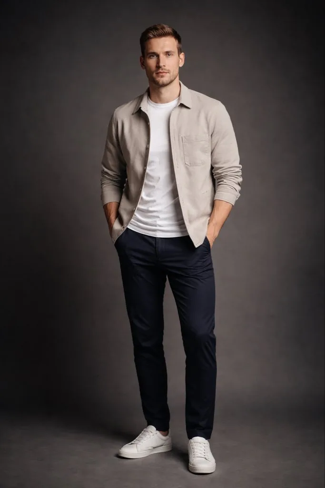

# Jack — by @j_smeaton99

[← Back to Community Examples](../../EXAMPLES.md) · Category: Photography · Model: `GPT Image`

<a href="https://x.com/j_smeaton99/status/2024491215035511151"></a>

Source: **[@j_smeaton99 on X](https://x.com/j_smeaton99/status/2024491215035511151)** · Creator: [Jack](https://x.com/j_smeaton99)

## Prompt

```text
Photorealistic studio portrait of an average British man in his late 20s to early 40s, natural appearance, realistic facial features, short well-groomed hair, light stubble or clean-shaven. He stands confidently with a relaxed posture, conveying quiet self-assurance.

He wears a stylish, comfortable, modern casual outfit, a well-fitted neutral-toned jacket or overshirt, premium plain t-shirt, tailored trousers or dark jeans, and clean minimalist sneakers. The look is contemporary, understated, and effortlessly fashionable.

Shot in a professional studio with minimal lighting: a soft key light focused on the subject with gentle shadow falloff, dark neutral background, high contrast, and strong subject isolation. Lighting highlights facial structure, textures, and silhouette while keeping the environment subtle.

Sharp focus on the subject, shallow depth of field, natural skin texture, realistic fabric detail, editorial fashion photography style, ultra-realistic, high resolution.

Negative prompt (optional): blur, heavy retouching, unrealistic skin, dramatic fashion styling, cluttered background, extra limbs, distortion, cartoonish style.
```

## Try it

Paste the prompt into **[vinano.ai](https://vinano.ai?utm_source=github&utm_medium=readme&utm_campaign=awesome-image-video-prompts-updating&utm_content=x-page-try)** to generate your own version.

> The image and prompt belong to @j_smeaton99 ([original post](https://x.com/j_smeaton99/status/2024491215035511151)) and are shown here with credit for reference. Creators can ask for changes or removal by opening an issue.
