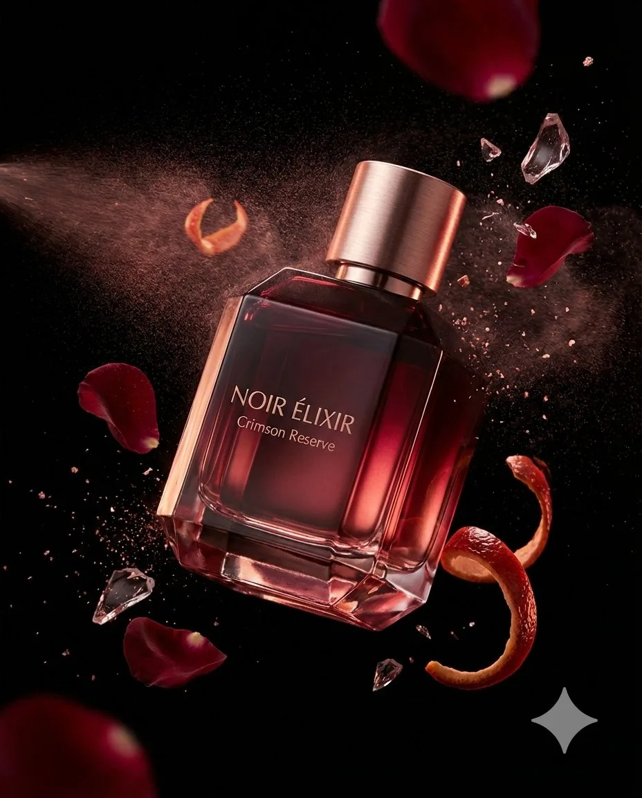

# Johnn — by @john_my07

[← Back to Community Examples](../../EXAMPLES.md) · Category: Product & Brand · Model: `GPT Image`

<a href="https://x.com/john_my07/status/2024420826016338208"></a>

Source: **[@john_my07 on X](https://x.com/john_my07/status/2024420826016338208)** · Creator: [Johnn](https://x.com/john_my07)

## Prompt

```text
{
  "master_prompt": {
    "product": {
      "type": "luxury perfume bottle",
      "brand_name": "NOIR ÉLIXIR",
      "fragrance_line": "Crimson Reserve",
      "container_shape": "faceted geometric crystal bottle with sharp elegant edges",
      "material": "high-clarity glass with deep ruby gradient tint",
      "finish": "polished reflective surfaces with subtle matte facets",
      "cap_design": "magnetic cap in brushed rose-gold metal with engraved emblem",
      "label_style": "minimal serif typography etched directly into glass with metallic inlay",
      "liquid_color": "rich crimson red with glowing ruby undertones"
    },
    "composition": {
      "scene_type": "ultra-cinematic luxury fragrance advertising photography",
      "orientation": "vertical",
      "aspect_ratio": "4:5",
      "camera_angle": "dramatic diagonal hero angle",
      "subject_position": "floating mid-air with slight forward tilt",
      "motion": "atomized perfume mist trails and fluid fragrance ribbons suspended in motion"
    },
    "environment": {
      "background": "deep black velvet gradient fading into shadow",
      "atmosphere": "volumetric mist with delicate fragrance vapor swirling around the bottle",
      "floating_elements": [
        "atomized perfume droplets suspended mid-air",
        "shattering crystal fragments catching highlights",
        "dark red rose petals drifting slowly",
        "glossy blood-orange peel curls",
        "fine rose-gold dust particles sparkling in light"
      ],
      "surface_effects": "micro condensation beads and polished reflections enhancing realism"
    },
    "lighting": {
      "style": "dramatic low-key studio lighting",
      "key_light": "soft directional light sculpting the glass facets",
      "rim_lights": "strong rim lights outlining silhouette and edges",
      "accent_lights": "warm ruby and rose-gold specular highlights on cap and engraved details",
      "shadow_depth": "deep cinematic shadows for luxury mood",
      "contrast": "high contrast with controlled reflections and luminous highlights"
    },
    "color_palette": {
      "primary_colors": ["obsidian black", "deep garnet", "ruby red"],
      "accent_colors": ["rose gold", "warm champagne glow"]
    },
    "camera_settings": {
      "lens": "macro cinema prime lens",
      "depth_of_field": "shallow depth isolating product from background",
      "focus_point": "engraved logo and glass surface textures",
      "bokeh": "smooth cinematic bokeh from reflective particles",
      "detail_capture": "extreme micro-detail clarity"
    },
    "render_quality": {
      "resolution": "8K ultra high definition",
      "render_style": "hyper-realistic luxury commercial render",
      "glass_physics": "accurate refraction and internal reflections",
      "liquid_simulation": "physically accurate fluid dynamics",
      "textures": "ultra-detailed crystal, metal, mist, and micro-droplet textures",
      "sharpness": "tack sharp product focus with cinematic background softness",
      "noise": "none",
      "artifacts": "none"
    },
    "mood": {
      "tone": "seductive, passionate, and ultra-premium",
      "emotion": "luxury, desire, elegance, timeless sophistication"
    },
    "final_output": {
      "usage": "high-end perfume campaign and luxury magazine advertising",
      "branding_focus": "hero product dominance with strong brand prestige",
      "visual_style": "cinematic fragrance commercial aesthetic"
    }
  }
}
```

## Try it

Paste the prompt into **[vinano.ai](https://vinano.ai?utm_source=github&utm_medium=readme&utm_campaign=awesome-image-video-prompts-updating&utm_content=x-page-try)** to generate your own version.

> The image and prompt belong to @john_my07 ([original post](https://x.com/john_my07/status/2024420826016338208)) and are shown here with credit for reference. Creators can ask for changes or removal by opening an issue.
