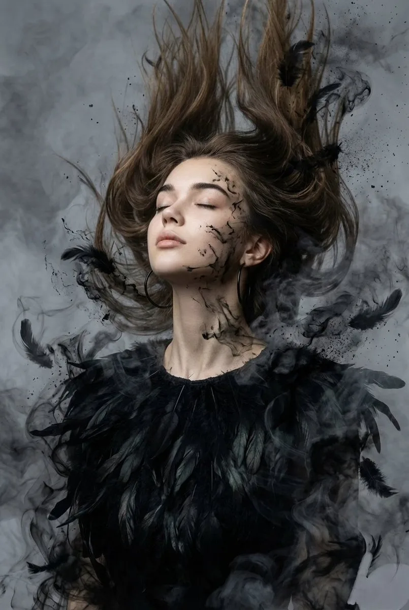

# 𝗦𝗮𝗻𝗶𝗮 — by @saniaspeaks_

[← Back to Community Examples](../../EXAMPLES.md) · Category: Photography · Model: `GPT Image`

<a href="https://x.com/saniaspeaks_/status/2007661583246471621"></a>

Source: **[@saniaspeaks_ on X](https://x.com/saniaspeaks_/status/2007661583246471621)** · Creator: [𝗦𝗮𝗻𝗶𝗮](https://x.com/saniaspeaks_)

## Prompt

```text
{
  "image_style": "surreal, dark cinematic, ethereal",
  "subject": {
    "person": "woman with features of reference image",
    "pose": "head tilted back, eyes closed, expression of freedom and release",
    "framing": "close-up portrait from chest upward",
    "clothing": "long-sleeve blouse made of organic, layered deep matte black raven feathers",
    "accessories": "large black hoop earrings"
  },
  "visual_effects": {
    "hair": "loose, dynamically suspended, blowing upward and forward by wind",
    "dissolving_elements": [
      "feathers and hair merging with black ink splatters",
      "charcoal dust",
      "wisps of dark smoke"
    ],
    "face_details": "fine black ink splatters and wisps spreading across face and neck"
  },
  "environment": {
    "background": "smoky gray, moody atmosphere",
    "elements": "thick, dense, layered smoke swirling throughout the frame"
  },
  "technical_aspects": {
    "resolution": "high-resolution",
    "lighting": "cinematic, moody, diffused through smoke"
  }
}
```

## Try it

Paste the prompt into **[vinano.ai](https://vinano.ai?utm_source=github&utm_medium=readme&utm_campaign=awesome-image-video-prompts-updating&utm_content=x-page-try)** to generate your own version.

> The image and prompt belong to @saniaspeaks_ ([original post](https://x.com/saniaspeaks_/status/2007661583246471621)) and are shown here with credit for reference. Creators can ask for changes or removal by opening an issue.
