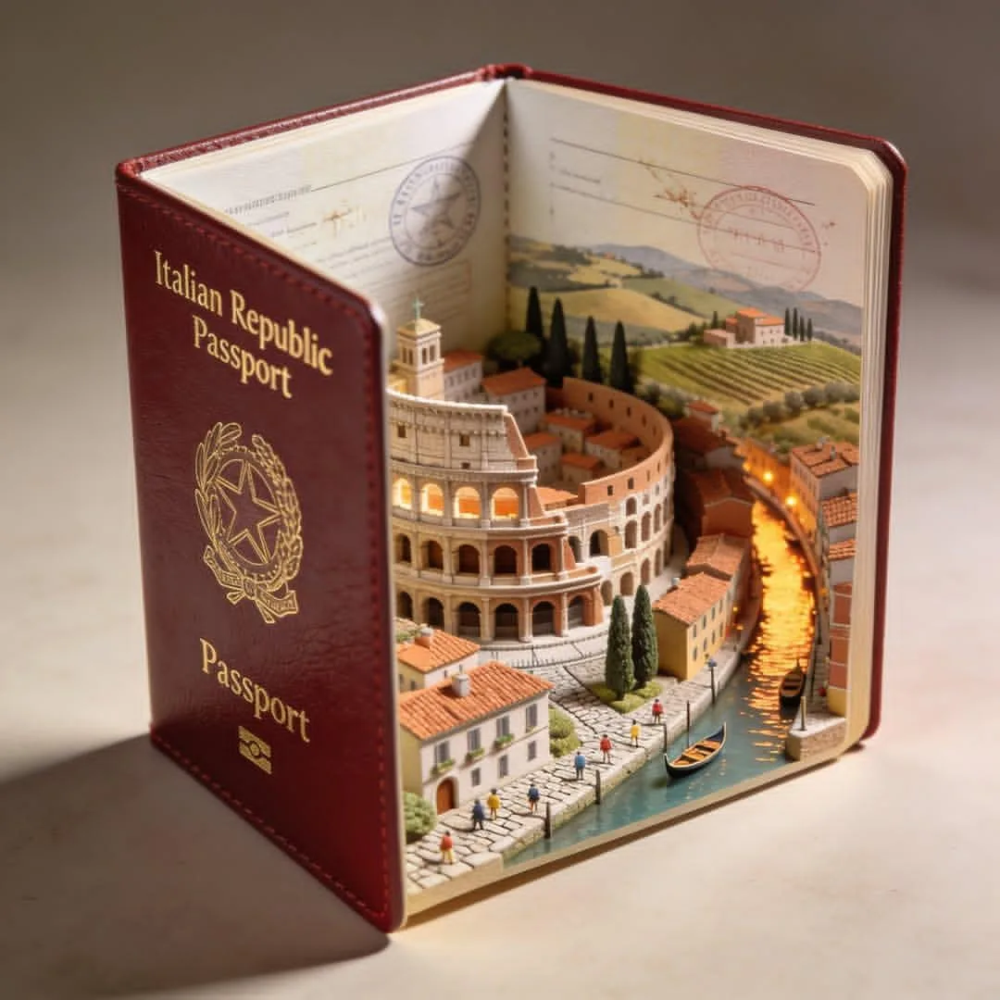

# simeon-sanai — by @Naiknelofar788

[← Back to Examples from X](../../EXAMPLES.md) · Category: Illustration & 3D · Model: `GPT Image`

<a href="https://x.com/Naiknelofar788/status/2022606746343317544"></a>

Original post: **[@Naiknelofar788 on X](https://x.com/Naiknelofar788/status/2022606746343317544)** · Creator: [simeon-sanai](https://x.com/Naiknelofar788)

## Prompt

```text
Hyper-realistic open [COUNTRY] passport on a studio surface, with gold-embossed “[Official Passport Name]” text and leather texture. From its pages rises a miniature 3D diorama of [COUNTRY], featuring [ICONIC LANDMARKS], [CITYSCAPES/COASTLINES/COUNTRYSIDE], and tiny human figures for scale. Passport pages show stamps and paper texture. Soft cinematic lighting, shallow depth of field, ultra-detailed photorealistic luxury style.
```

## Try it

Paste the prompt into **[vinano.ai](https://vinano.ai?utm_source=github&utm_medium=readme&utm_campaign=awesome-image-video-prompts-updating&utm_content=x-page-try)** to generate your own version.

> The image and prompt belong to [@Naiknelofar788](https://x.com/Naiknelofar788) and are shown here with credit for reference. Creators can ask for changes or removal by opening an issue.
