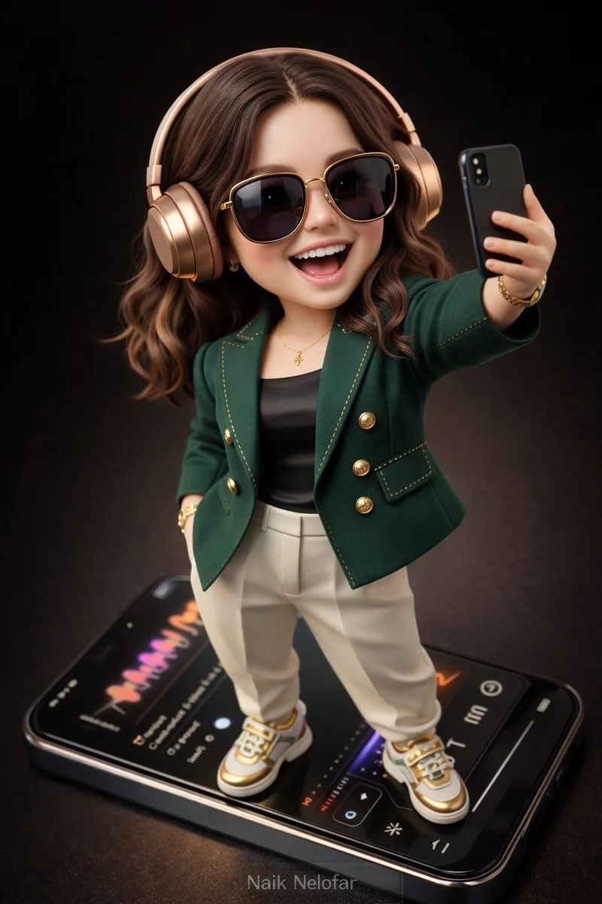

# simeon-sanai — by @Naiknelofar788

[← Back to Community Examples](../../EXAMPLES.md) · Category: Illustration & 3D · Model: `GPT Image`

<a href="https://x.com/Naiknelofar788/status/2031741057105526932"></a>

Source: **[@Naiknelofar788 on X](https://x.com/Naiknelofar788/status/2031741057105526932)** · Creator: [simeon-sanai](https://x.com/Naiknelofar788)

## Prompt

```text
Create a high-detail 3D semi-realistic chibi character with slightly exaggerated cute proportions but with photorealistic facial rendering, natural skin pores, realistic lighting, and finely detailed hair strands. The character should look like a collectible designer toy figure with smooth surfaces, high-end materials, and ultra-clean edges. The character is styled in an fashion look: A tailored designer jacket in deep emerald green with gold stitching accents A sleek black silk fitted top underneath High-fashion tapered trousers in matte ivory tone  designer sneakers / footwear in white and gold with polished details Accessories must feel ultra- and fashionable:  oversized sunglasses with glossy black lenses and gold frame   wristwatch with metallic gold case and elegant dial Subtle designer bracelet and minimal accents The character stands confidently on top of a giant modern smartphone, like a collectible display piece. They are wearing stylish wireless over-ear headphones in metallic rose gold and holding the phone slightly forward while taking a playful joyful selfie, smiling and laughing with energetic expression. The smartphone screen displays a realistic modern music-player interface with colorful waveform animations and elegant UI elements. Scene style and lighting: Background: deep cinematic dark brown gradient studio backdrop Lighting: soft studio lighting with subtle reflections and rim light Materials: high-quality fabric textures, polished metals, and realistic plastics Style: collectible toy aesthetic mixed with semi-realistic chibi design Camera perspective: Aerial / top-down camera angle Slight cinematic depth of field for realism Rendering quality: Ultra-detailed 3D render 8K resolution smooth shading hyper-clean edges high clarity Add a small elegant watermark text “Naik Nelofar ” at the bottom of the image, subtle but clearly readable. Aspect ratio: 3:4 vertical composition
```

## Try it

Paste the prompt into **[vinano.ai](https://vinano.ai?utm_source=github&utm_medium=readme&utm_campaign=awesome-image-video-prompts-updating&utm_content=x-page-try)** to generate your own version.

> The image and prompt belong to @Naiknelofar788 ([original post](https://x.com/Naiknelofar788/status/2031741057105526932)) and are shown here with credit for reference. Creators can ask for changes or removal by opening an issue.
