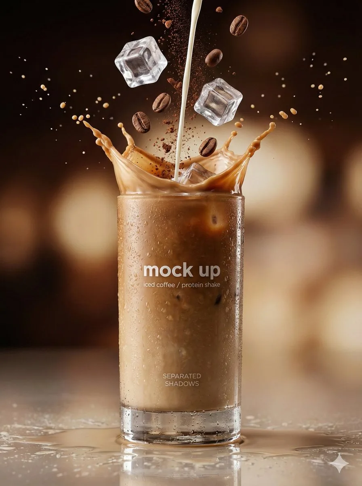

# Johnn — by @john_my07

[← Back to Examples from X](../../EXAMPLES.md) · Category: Food & Drink · Model: `GPT Image`

<a href="https://x.com/john_my07/status/2019431396885070327"></a>

Original post: **[@john_my07 on X](https://x.com/john_my07/status/2019431396885070327)** · Creator: [Johnn](https://x.com/john_my07)

## Prompt

```text
{
  "master_prompt": {
    "global_settings": {
      "resolution": "8K ultra-high-definition",
      "aspect_ratio": "3:4 vertical",
      "style": "hyper-realistic AI-edited commercial beverage photography",
      "sharpness": "extreme clarity, micro-detail visibility",
      "lighting_quality": "cinematic studio lighting with controlled highlights and shadows",
      "motion_freeze": "high-speed capture, frozen liquid splashes and particles",
      "noise": "none",
      "artifacts": "none"
    },

    "module_1_glass_beverage_style": {
      "subject": {
        "type": "transparent glass",
        "glass_style": "tall cylindrical glass with thick base",
        "surface_details": "cold condensation droplets on outer glass surface",
        "fill_level": "80 percent full",
        "label_text_visible": [
          "mock up",
          "iced coffee / protein shake",
          "SEPARATED SHADOWS"
        ]
      },

      "liquid_and_layers": {
        "beverage_type": "iced latte or chocolate protein shake",
        "liquid_color": "rich coffee brown or creamy cocoa",
        "layering": "soft milk-to-coffee gradient with subtle swirls",
        "texture": "smooth, thick, glossy, realistic viscosity"
      },

      "motion_and_splash": {
        "action": "liquid splash erupting from inside the glass",
        "splash_behavior": "curved arcs rising above rim with suspended droplets",
        "droplet_detail": "micro droplets frozen mid-air with sharp definition"
      },

      "floating_elements": {
        "ice_cubes": "large clear ice cubes rotating in mid-air",
        "coffee_beans_or_cocoa": "roasted coffee beans or cocoa powder particles floating",
        "cream_stream": "thin stream of milk or cream pouring into glass"
      },

      "pose_and_camera": {
        "position": "centered hero composition",
        "angle": "three-quarter close-up",
        "camera_feel": "slightly low angle for premium, powerful presence"
      },

      "background": {
        "color_palette": "deep espresso brown fading into warm beige highlights",
        "bokeh": "soft cinematic bokeh lights with warm glow",
        "atmosphere": "luxurious, indulgent, high-end café mood"
      },

      "surface_and_reflection": {
        "base": "wet reflective surface with subtle liquid pooling",
        "shadow_style": "clean, soft separated shadow beneath glass",
        "reflection_quality": "controlled highlights along glass edges"
      }
    }
  }
}
```

## Try it

Paste the prompt into **[vinano.ai](https://vinano.ai?utm_source=github&utm_medium=readme&utm_campaign=awesome-image-video-prompts-updating&utm_content=x-page-try)** to generate your own version.

> The image and prompt belong to [@john_my07](https://x.com/john_my07) and are shown here with credit for reference. Creators can ask for changes or removal by opening an issue.
