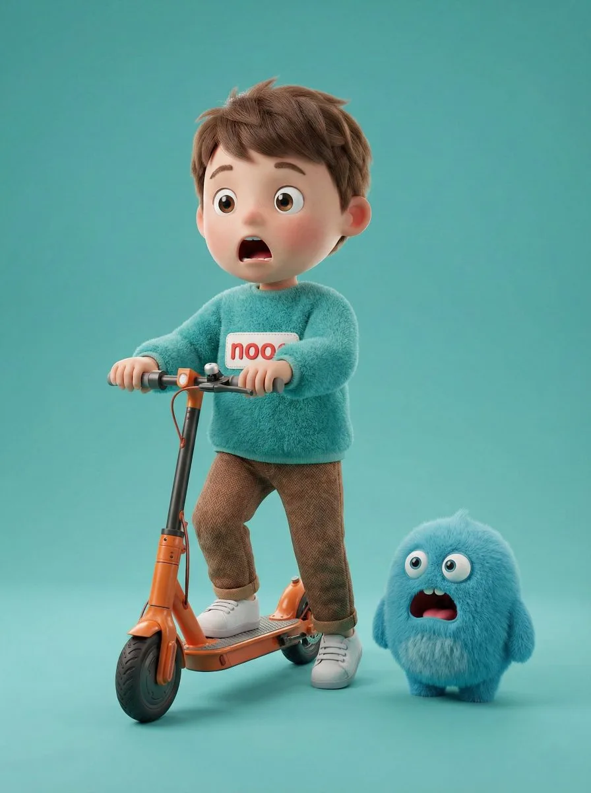

# Heisenberg — by @rovvmut_

[← Back to Examples from X](../../EXAMPLES.md) · Category: Illustration & 3D · Model: `GPT Image`

<a href="https://x.com/rovvmut_/status/2014987855517614460"></a>

Original post: **[@rovvmut_ on X](https://x.com/rovvmut_/status/2014987855517614460)** · Creator: [Heisenberg](https://x.com/rovvmut_)

## Prompt

```text
A high-quality 3D render of a cute young boy riding an orange electric scooter next to a small, round, furry blue monster. Both characters have shocked expressions with wide eyes and open mouths. The boy is wearing a highly textured, fuzzy teal sweater with a white patch that reads "noo" in red text, along with brown patterned pants and white sneakers. Clean teal studio background, soft lighting.
```

## Try it

Paste the prompt into **[vinano.ai](https://vinano.ai?utm_source=github&utm_medium=readme&utm_campaign=awesome-image-video-prompts-updating&utm_content=x-page-try)** to generate your own version.

> The image and prompt belong to [@rovvmut_](https://x.com/rovvmut_) and are shown here with credit for reference. Creators can ask for changes or removal by opening an issue.
