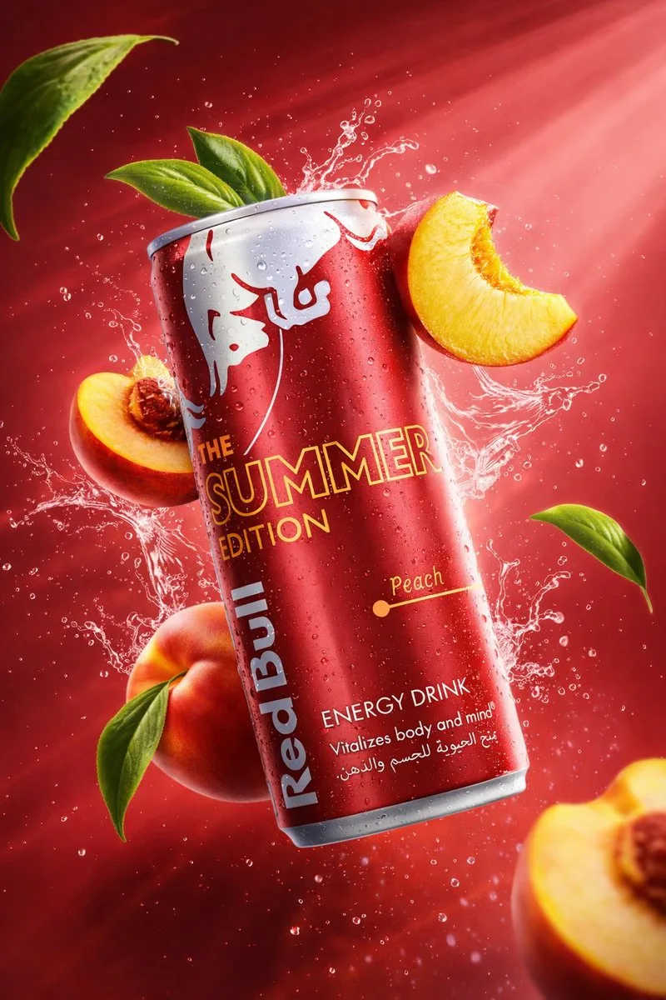

# ShaHid WaNii — by @meng_dagg695

[← Back to Community Examples](../../EXAMPLES.md) · Category: Food & Drink · Model: `GPT Image`

<a href="https://x.com/meng_dagg695/status/2010681413562155183"></a>

Source: **[@meng_dagg695 on X](https://x.com/meng_dagg695/status/2010681413562155183)** · Creator: [ShaHid WaNii](https://x.com/meng_dagg695)

## Prompt

```text
{
  "global_settings": {
    "resolution": "8K ultra high definition",
    "aspect_ratio": "3:4",
    "quality": "hyper-realistic commercial product photography",
    "focus": "sharp foreground, controlled depth of field",
    "lighting_style": "cinematic studio lighting with volumetric light rays",
    "motion": "frozen action splash photography",
    "render_style": "AI-edited, ultra-detailed, advertising-grade"
  },

  "module_1_purple_acai_style": {
    "primary_subject": {
      "object": "slim aluminum energy drink can",
      "orientation": "slightly tilted clockwise, floating mid-air",
      "surface": "matte metallic purple with fine water droplets",
      "branding": {
        "text_visible": ["THE PURPLE EDITION", "Açaí Berry", "ENERGY DRINK"],
        "graphics": "stylized bull illustration in white"
      }
    },
    "background": {
      "color": "deep purple gradient",
      "lighting": "bright diagonal light rays from upper right",
      "atmosphere": "misty with fine water particles"
    },
    "surrounding_elements": {
      "fruits": [
        {
          "type": "blueberries",
          "state": ["whole", "one halved"],
          "texture": "glossy skin, visible pulp on cut fruit"
        }
      ],
      "leaves": "small green leaves attached to berries",
      "liquid": "clear water splashes forming arcs around can"
    },
    "motion_details": {
      "water": "dynamic splash trails frozen mid-air",
      "droplets": "micro droplets suspended around subject"
    },
    "color_palette": ["purple", "violet", "deep blue", "white", "fresh green"]
  },

  "module_2_white_coconut_berry_style": {
    "primary_subject": {
      "object": "slim aluminum energy drink can",
      "orientation": "slightly tilted counter-clockwise, floating",
      "surface": "white metallic finish with condensation droplets",
      "branding": {
        "text_visible": ["THE WHITE EDITION", "Coconut & Berry", "ENERGY DRINK"],
        "graphics": "bull illustration in gray"
      }
    },
    "background": {
      "color": "sky blue gradient",
      "lighting": "strong sunlight beams from upper right",
      "atmosphere": "clean, airy, refreshing"
    },
    "surrounding_elements": {
      "fruits": [
        {
          "type": "blueberries",
          "state": "whole",
          "texture": "smooth, reflective skin"
        },
        {
          "type": "coconut",
          "state": "broken slices",
          "texture": "white flesh with dark brown shell"
        }

      "ice": {
        "form": "transparent ice cubes",
        "detail": "sharp edges, internal cracks visible"
      },
      "liquid": "clear water splashes"
    },
    "motion_details": {
      "water": "curved splash paths wrapping around can",
      "ice": "suspended mid-air with subtle rotation"
    },
    "color_palette": ["white", "light blue", "cyan", "natural brown", "cool gray"]
  
  "module_3_green_lemon_mojito_style": {
    "primary_subject": {
      "object": "tall soda can",
      "orientation": "tilted slightly clockwise, floating",
      "surface": "dark green metallic body with lighter green label",
      "branding": {
        "text_visible": ["LEMON SODA", "MOJITO", "L’ORIGINALE MOJITO ANALCOLICO ITALIANO"],
        "logo": "CRODO emblem at top
    "background": {
      "color": "vibrant green gradient",
      "lighting": "intense sun flare from upper right"
    },
    "surrounding_elements": {
      "fruits": [
        {
          "type": "lime",
          "state": ["whole", "sliced wedge"],
          "texture": "visible citrus pulp, glossy rind"
        }
      ],
      "leaves": "fresh mint leaves with visible veins",
      "liquid": "sparkling water splashes"
    },
    "motion_details": {
      "water": "explosive splash bursts around can",
      "droplets": "dense spray of fine droplets"
    },
    "color_palette": ["lime green", "dark green", "yellow-green", "white"]
  }
```

## Try it

Paste the prompt into **[vinano.ai](https://vinano.ai?utm_source=github&utm_medium=readme&utm_campaign=awesome-image-video-prompts-updating&utm_content=x-page-try)** to generate your own version.

> The image and prompt belong to @meng_dagg695 ([original post](https://x.com/meng_dagg695/status/2010681413562155183)) and are shown here with credit for reference. Creators can ask for changes or removal by opening an issue.
