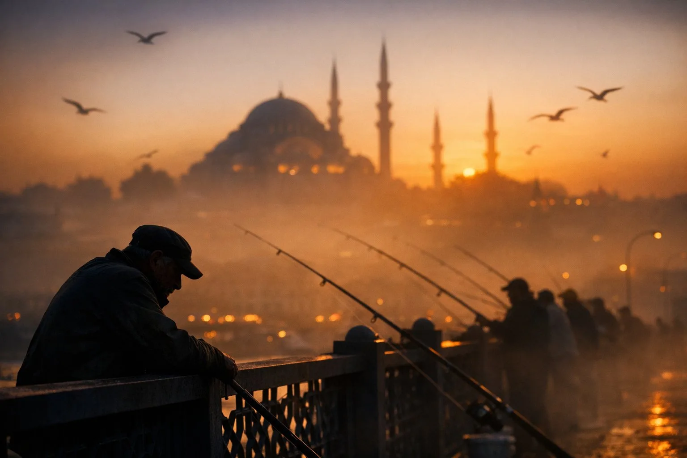

# Ozan Sihay — by @ozan_sihay

[← Back to Community Examples](../../EXAMPLES.md) · Category: Photography · Model: `GPT Image`

<a href="https://x.com/ozan_sihay/status/2001003144566681621"></a>

Source: **[@ozan_sihay on X](https://x.com/ozan_sihay/status/2001003144566681621)** · Creator: [Ozan Sihay](https://x.com/ozan_sihay)

## Prompt

```text
A cinematic silhouette shot of local fishermen lining the Galata Bridge in Istanbul during sunset. In the foreground, a weary fisherman leans against the railing, looking at the sea. The background features the hazy, dreamlike silhouette of the Süleymaniye Mosque and seagulls flying over the Golden Horn. Warm orange and deep blue color palette. Shot on Sony A7R IV with Sony FE 85mm f/1.4 GM lens at f/1.8. Atmospheric haze, emotional storytelling, award-winning travel photography.
```

## Try it

Paste the prompt into **[vinano.ai](https://vinano.ai?utm_source=github&utm_medium=readme&utm_campaign=awesome-image-video-prompts-updating&utm_content=x-page-try)** to generate your own version.

> The image and prompt belong to @ozan_sihay ([original post](https://x.com/ozan_sihay/status/2001003144566681621)) and are shown here with credit for reference. Creators can ask for changes or removal by opening an issue.
