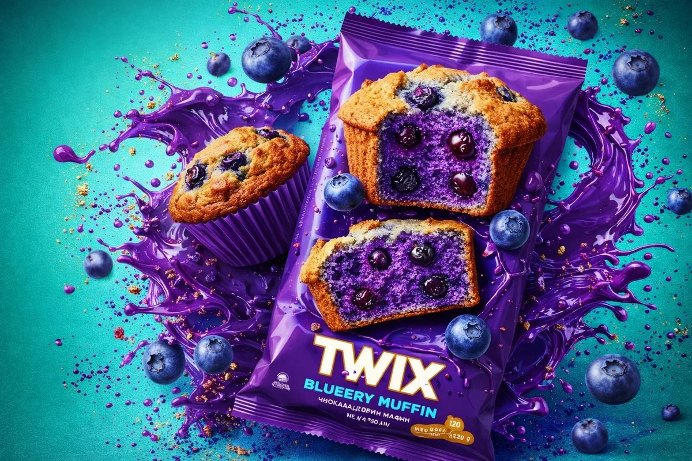

# ShaHid WaNii — by @meng_dagg695

[← Back to Examples from X](../../EXAMPLES.md) · Category: Food & Drink · Model: `GPT Image`

<a href="https://x.com/meng_dagg695/status/2012353813425144239"></a>

Original post: **[@meng_dagg695 on X](https://x.com/meng_dagg695/status/2012353813425144239)** · Creator: [ShaHid WaNii](https://x.com/meng_dagg695)

## Prompt

```text
{
  "global_settings": {
    "resolution": "8K",
    "quality": "ultra-high",
    "render_style": "hyperrealistic commercial CGI",
    "lighting": "studio-grade, high-contrast, glossy highlights",
    "focus": "extreme sharpness, macro-level texture visibility",
    "color_depth": "rich, saturated, clean gradients",
    "noise": "none",
    "artifacts": "none"
  },

  "Module_1_Image_1_Style": {
    "subject": {
      "primary_object": "Snickers mint chocolate bar in turquoise wrapper",
      "pose": "diagonally tilted, floating mid-air",
      "orientation": "top-left to bottom-right angle",
      "visibility": "full front-facing packaging visible"
    },
    "packaging_details": {
      "colors": ["turquoise", "brown", "white", "blue"],
      "text_visible": ["SNICKERS", "SNICKES", "with mint"],
      "surface": "glossy plastic wrapper with subtle creases",
      "product_image": "chocolate bar segment printed on wrapper"
    },
    "ingredients_visible": [
      "fresh mint leaves",
      "whole almonds",
      "white sugar-like spherical candies",
      "chocolate bar pieces"
    ],
    "motion_elements": {
      "liquid": "clear water splash forming a curved arc around the bar",
      "droplets": "floating water bubbles and droplets suspended in air"
    },
    "background": {
      "color": "light aqua blue",
      "texture": "smooth gradient",
      "depth": "foreground and background elements clearly separated"
    },
    "lighting": {
      "key_light": "bright frontal studio light",
      "rim_light": "cool highlights on water edges",
      "reflections": "strong specular highlights on wrapper and liquid"
    }
  },

  "Module_2_Image_2_Style": {
    "subject": {
      "primary_object": "Hershey’s Special Dark chocolate mint packaging",
      "pose": "upright, centered, slightly elevated",
      "orientation": "front-facing, symmetrical composition"
    },
    "packaging_details": {
      "colors": ["black", "green", "yellow"],
      "text_visible": [
        "SPECIAL DARK",
        "HERSHEY’S",
        "SABOR MENTA",
        "60% DE CACAU",
        "100 g"
      ],
      "surface": "matte-black wrapper with glossy highlights"
    },
    "ingredients_visible": [
      "mint leaves",
      "embossed Hershey’s chocolate squares"
    ],
    "motion_elements": {
      "liquid": "thick molten chocolate splashes wrapping around the package",
      "droplets": "small chocolate particles suspended mid-air"
    },
    "background": {
      "color": "deep green gradient",
      "base_surface": "liquid chocolate pool beneath the package"
    },
    "lighting": {
      "key_light": "warm directional light",
      "accent_light": "golden highlights on chocolate splashes",
      "contrast": "high contrast between dark wrapper and green background"
    }
  },

  "Module_3_Image_3_Style": {
    "subject": {
      "primary_object": "Twix Blueberry Muffin packaged snack",
      "pose": "slightly tilted, floating above background",
      "orientation": "front-facing with angled depth"
    },
    "packaging_details": {
      "colors": ["purple", "gold", "white"],
      "text_visible": ["TWIX", "BLUEBERRY MUFFIN"],
      "surface": "glossy purple plastic wrapper"
    },
    "food_elements": [
      "blueberry muffin",
      "sliced muffin revealing purple interior",
      "whole blueberries"
    ],
    "motion_elements": {
      "liquid": "purple splash forming circular motion behind the product",
      "particles": "crumbs and droplets suspended in air"
    },
    "background": {
      "color": "turquoise-blue",
      "texture": "clean gradient with high saturation"
    },
    "lighting": {
      "key_light": "bright neutral studio light",
      "rim_light": "purple-tinted highlights on splash edges",
      "detail_visibility": "crumb texture and muffin pores clearly visible"
    }
  },
```

## Try it

Paste the prompt into **[vinano.ai](https://vinano.ai?utm_source=github&utm_medium=readme&utm_campaign=awesome-image-video-prompts-updating&utm_content=x-page-try)** to generate your own version.

> The image and prompt belong to [@meng_dagg695](https://x.com/meng_dagg695) and are shown here with credit for reference. Creators can ask for changes or removal by opening an issue.
