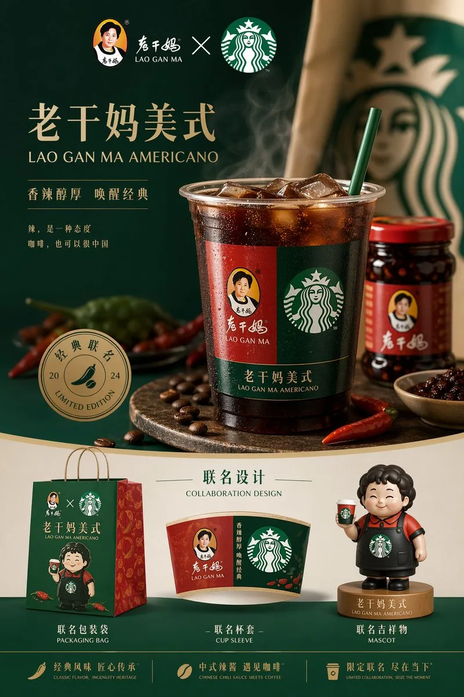

# 黄小木 — by @ai_xiaomu

[← Back to Community Examples](../../EXAMPLES.md) · Category: Poster Design · Model: `GPT Image`

<a href="https://x.com/ai_xiaomu/status/2046603938485637446"></a>

Source: **[@ai_xiaomu on X](https://x.com/ai_xiaomu/status/2046603938485637446)** · Creator: [黄小木](https://x.com/ai_xiaomu)

## Prompt

```text
生成完整高端的品牌运营图 ，产品是老干妈和星巴克的联名款：老干妈美式，中间是主图，下面放一些联名的设计，包装袋、杯套以及吉祥物。
```

## Try it

Paste the prompt into **[vinano.ai](https://vinano.ai?utm_source=github&utm_medium=readme&utm_campaign=awesome-image-video-prompts-updating&utm_content=x-page-try)** to generate your own version.

> The image and prompt belong to @ai_xiaomu ([original post](https://x.com/ai_xiaomu/status/2046603938485637446)) and are shown here with credit for reference. Creators can ask for changes or removal by opening an issue.
