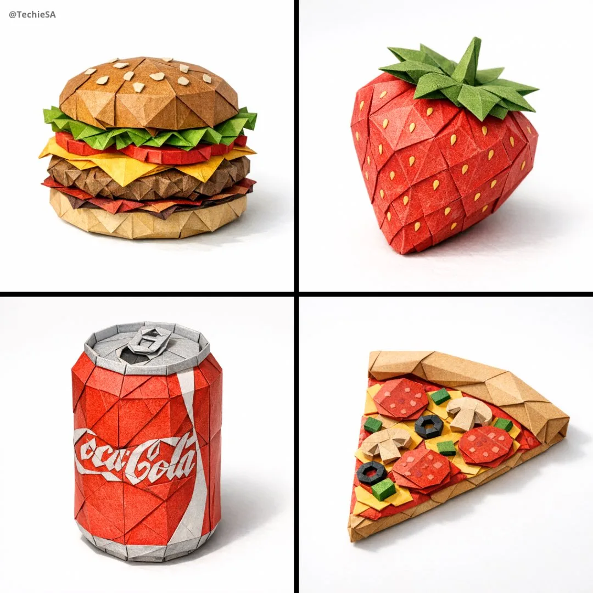

# TechieSA — by @TechieBySA

[← Back to Examples from X](../../EXAMPLES.md) · Category: Illustration & 3D · Model: `GPT Image`

<a href="https://x.com/TechieBySA/status/2007809696334479420"></a>

Original post: **[@TechieBySA on X](https://x.com/TechieBySA/status/2007809696334479420)** · Creator: [TechieSA](https://x.com/TechieBySA)

## Prompt

```text
A hyper-detailed origami [FOOD ITEM] folded from realistic colored paper with visible creases and paper texture. Complex geometric folds capture the food’s shape, layers, and distinctive features. Placed on clean surface with soft shadows, minimalist food art photography style
```

## Try it

Paste the prompt into **[vinano.ai](https://vinano.ai?utm_source=github&utm_medium=readme&utm_campaign=awesome-image-video-prompts-updating&utm_content=x-page-try)** to generate your own version.

> The image and prompt belong to [@TechieBySA](https://x.com/TechieBySA) and are shown here with credit for reference. Creators can ask for changes or removal by opening an issue.
